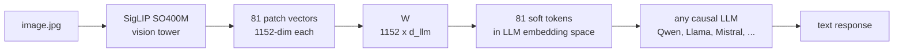
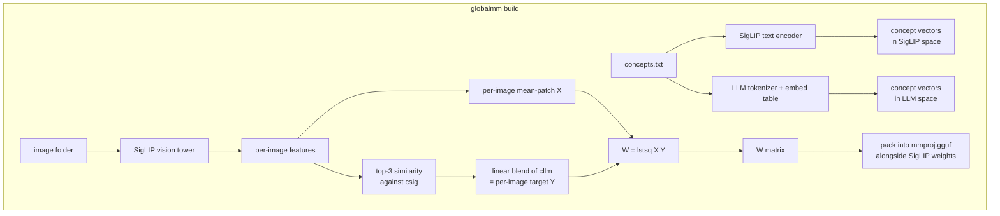

<div align="center">
  <h1>globalmm</h1>
  <p><strong>Give any local LLM vision without training</strong></p>

  <a href="https://pypi.org/project/globalmm/"></a>
  <a href="https://pypi.org/project/globalmm/"></a>
  <a href="LICENSE"></a>
</div>

<br>

`globalmm` builds an `mmproj.gguf` file that plugs into `llama.cpp` and lets any
local LLM accept images. The projector inside the mmproj is a single 1152xD
matrix, fit in seconds with closed-form least squares. Building it needs no
gradient descent, no GPU time and no paired image-caption dataset.

## What you get



SigLIP (left of `W`) and your LLM (right of `W`) both stay frozen. `W` is the
only part `globalmm` computes, and at runtime it costs one matrix
multiplication.

## Quick start

Install with [uv](https://github.com/astral-sh/uv):

```bash
uv tool install globalmm
```

Or run it once without installing:

```bash
uvx globalmm build --llm ... --concepts ... --out ...
```

You need two things to build an mmproj:

1. A target LLM (any Hugging Face causal LM with a standard embedding table).
2. A list of concept words that describe the visual domain you care about.
   One word per line, plain text. An example covering everyday COCO-style
   objects lives in `data/concepts.txt`.

Then:

```bash
globalmm build \
    --llm Qwen/Qwen2.5-1.5B-Instruct \
    --concepts data/concepts.txt \
    --out qwen.gguf
```

First run takes a few minutes because it downloads COCO val2017 (about 800 MB)
to `./.globalmm/images/` and runs a one-time SigLIP encoding pass. Later runs
reuse the cache and finish in about thirty seconds.

To use your own images instead of COCO, point `--images` at any folder of
JPEGs or PNGs.

## Running inference with llama.cpp

Once you have `qwen.gguf` (the mmproj) and an existing `qwen2.5-1.5b.gguf`
(the regular LLM weights), llama.cpp handles the rest:

```bash
llama-mtmd-cli \
    -m qwen2.5-1.5b.gguf \
    --mmproj qwen.gguf \
    --image cat.jpg \
    -p "Describe what you see."
```

Or through the OpenAI-compatible server:

```bash
llama-server -m qwen2.5-1.5b.gguf --mmproj qwen.gguf --port 8080
```

Inference runs entirely in llama.cpp and needs neither Python, transformers nor a GPU.

## How it works

The core idea is that SigLIP and any causal LLM both speak dense vectors, just
in different spaces. SigLIP encodes an image into 81 patch vectors of dimension
1152. An LLM expects token embeddings of its own hidden size. A linear map `W`
with shape (1152, d_llm) is enough to bridge the two, provided we can produce
paired samples to fit it against.



Step by step:

1. Encode each concept word twice. Once through SigLIP's text encoder, which
   puts words and images into the same vector space (SigLIP was trained so
   that a picture of a cat and the word "cat" end up near each other). Once
   through the target LLM's embedding table, which gives the LLM's own
   internal vector for each word.
2. For each image in the cache, take the SigLIP image vector and compute
   cosine similarity against every concept in SigLIP space. Pick the top three.
3. Blend the corresponding LLM embeddings with weights proportional to those
   similarities. This is the image's target `Y`.
4. Take the per-image mean of SigLIP's 81 patch vectors as the input `X`.
5. Cap the number of images per primary concept at fifty so the COCO
   distribution does not dominate `W`.
6. Solve `W = lstsq(X, Y)`. The whole step takes under a second on CPU.

At inference the mmproj embeds SigLIP's weights plus `W` in a single `.gguf`
file. llama.cpp loads it through the gemma3 projector path, runs SigLIP on the
input image, multiplies the 81 patch vectors by `W`, and splices the result
into the prompt wherever the image token sits.

## Why this works at all

SigLIP already knows how to match images to words. It was trained on millions
of image and caption pairs until similar things landed close together in its
vector space. That means the top three nearest concepts for any image are
already a decent guess at what is in the picture. We use those three words
to describe the image in the LLM's own vocabulary, then solve for one matrix
that turns SigLIP image vectors into something that looks like those
descriptions. Because we fit on average image vectors, the same matrix also
works when applied to individual patches at run time, which gives the LLM
a small set of soft tokens that point toward the content of the image.

This reuses the work SigLIP already did, and it is much weaker than a vision
model trained end to end. In exchange, building a projector for a new LLM takes
seconds, where training one would take hours or days on a GPU.

## Limitations

1. **Per-LLM.** `W` is tied to a specific LLM's embedding table. Swapping LLMs
   means rebuilding the mmproj, which is fast and takes one CLI command.
2. **Concept list matters.** `globalmm` can only describe things that appear
   in the concept list, so for medical scans you would put medical terms in
   `concepts.txt`, and for car parts a list of car parts. The default example
   file covers everyday objects only.
3. **Tokenizer BPE artifacts.** Words that split into multiple subword tokens
   such as `giraffe` (into `gir` and `affe`) are harder to recover. They end
   up as averaged fragments and the LLM may or may not put them back together.
4. **Gemma3 projector only.** The mmproj uses the `clip.projector_type=gemma3`
   metadata key because that is the only linear single-matrix projector
   llama.cpp ships. Any LLM that llama.cpp supports will work, but the target
   LLM's hidden size has to match the `projection_dim` in the mmproj, which is
   why the projector is per-LLM.
5. **SigLIP is frozen.** If SigLIP fails to see something in the image, no
   projector can recover it. State-of-the-art quality still needs proper
   multimodal training.

## Research: trained connectors for grounding and audio

[`research/`](research/README.md) holds experiments that are separate from the `globalmm` package
above. The package itself is unchanged. The experiments keep the same layout (a frozen encoder, a
middle piece, a frozen LLM) and train the middle piece instead of fitting it in one step. Training
takes a few GPU hours, and the LLM then learns where objects are in the image as well as what they
are. There are two trained designs. The **connector** reads the vision tower's output directly. The
**connector + donor** design first passes the image tokens through the first 4 language-model layers
of a real vision-language model (the donor), whose attention lets every image token use context from
the rest of the image.

The same results are also written up as a [blog post](https://claude.ai/artifact/1GaWzPWWAUNgq8XmMzGi4S) with interactive examples, audio clips
and charts.

| | `globalmm` package (above) | Research: connector | Research: connector + donor |
|---|---|---|---|
| Frozen encoder | SigLIP SO400M | Qwen3.8 vision tower (or Whisper for audio) | Qwen3-VL-2B vision tower + its first 4 LLM layers |
| Middle piece | one matrix `W` (1152 × d) | small trained network (30.7M params) | small trained network (16.8M params) |
| How it is made | least squares on CPU, seconds | trained through the frozen LLM, 3 to 3.5 GPU-hours | same, 3.5 GPU-hours |
| Learns from | concept words blended per image | target answers: boxes, captions, transcripts | same |
| Tokens sent to the LLM | 81 soft tokens pointing at *what* is in the image | one per 32×32-pixel patch, keeping layout | same |
| Bounding boxes (held-out COCO, Acc@0.5) | no | 74% | 86% |
| Runs in llama.cpp | yes | yes, as an mmproj | not yet (PyTorch only) |
| New LLM | rebuild in seconds | retrain the connector | retrain the connector |

Results so far, all with an unmodified Llama-3.2-1B:

- **Image grounding.** Qwen3.8's vision tower plus a 30.7M-parameter connector gives the text-only
  Llama-3.2-1B bounding boxes. "Where is the X?" Acc@0.5 is 74% on held-out COCO, against 5% for a
  no-image prior.
- **Connector + donor.** With Qwen3-VL-2B's vision tower and first 4 LLM layers (frozen) in front of
  a 16.8M-parameter connector, the same test reaches 86% with identical training (Qwen3-VL-2B itself
  scores 91%). This design runs in PyTorch for now.
- **Audio.** The Whisper-large-v3-turbo encoder plus a 46M-parameter connector gives the same Llama
  speech transcription at 5.3% WER and sound-event timestamps.
- **Analysis.** Why closed-form mappings fail on image tokens, where trained tokens end up in
  Llama's latent space, a training-free test of copying a VLM's layers, and a hybrid of the two.

Each connector took about 3 to 3.5 GPU-hours on one 8 GB laptop GPU. These experiments are not part
of the `globalmm` package yet.

## API

```python
from globalmm.projector import compute_W
from globalmm.build_mmproj import build_mmproj

W = compute_W(
    llm_name="Qwen/Qwen2.5-1.5B-Instruct",
    concepts_path="data/concepts.txt",
)
build_mmproj(W, "qwen.gguf")
```

Same result as the CLI, useful for scripting or embedding in a larger pipeline.

## References

The approach borrows from a few papers and projects:

1. Zhai et al., *Sigmoid Loss for Language Image Pre-Training*, ICCV 2023.
   [arxiv.org/abs/2303.15343](https://arxiv.org/abs/2303.15343). SigLIP is
   the frozen vision backbone. It was trained so that images and their
   matching text land in the same vector space, which is what makes the
   zero-shot concept labeling step work.
2. Moschella et al., *Relative Representations Enable Zero-Shot Latent Space
   Communication*, ICLR 2023.
   [arxiv.org/abs/2209.15430](https://arxiv.org/abs/2209.15430). The broader
   idea that two frozen embedding spaces can be linked via a fixed set of
   anchor points without joint training.
3. Smith et al., *Offline Bilingual Word Vectors, Orthogonal Transformations
   and the Inverted Softmax*, ICLR 2017.
   [arxiv.org/abs/1702.03859](https://arxiv.org/abs/1702.03859). Shows that
   you can link two separate word embedding spaces with a single matrix
   computed in closed form. The same trick is what globalmm does between
   SigLIP and the target LLM.
4. Liu et al., *Visual Instruction Tuning* (LLaVA), NeurIPS 2023.
   [arxiv.org/abs/2304.08485](https://arxiv.org/abs/2304.08485). The trained
   linear projector baseline that globalmm replaces with closed-form lstsq.
5. [ggml-org/llama.cpp](https://github.com/ggml-org/llama.cpp). The runtime
   that loads the mmproj and runs SigLIP plus W plus the LLM in a single
   process. The gemma3 projector type in `clip.cpp` is the specific
   format globalmm writes into.

## License

[MIT](LICENSE).
