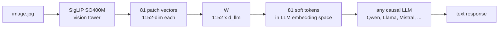
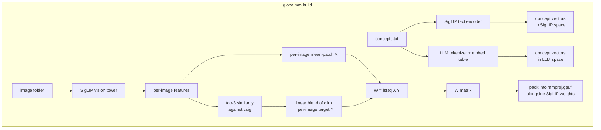

<div align="center">
  <h1>globalmm</h1>
  <p><strong>Give any local LLM vision without training</strong></p>

  <a href="https://pypi.org/project/globalmm/"></a>
  <a href="https://pypi.org/project/globalmm/"></a>
  <a href="LICENSE"></a>
</div>

<br>

`globalmm` builds an `mmproj.gguf` file that plugs into `llama.cpp` and lets any
local LLM accept images. The projector inside the mmproj is a single 1152xD
matrix, fit in seconds via closed-form least squares. No gradient descent, no
hours of GPU time, no paired image-caption dataset.

## What you get



Everything to the left of `W` is frozen SigLIP. Everything to the right of `W`
is your frozen LLM. `W` is the only thing `globalmm` computes, and it is a
single matrix multiplication at runtime.

## Quick start

Install with [uv](https://github.com/astral-sh/uv):

```bash
uv tool install globalmm
```

Or run it once without installing:

```bash
uvx globalmm build --llm ... --concepts ... --out ...
```

You need two things to build an mmproj:

1. A target LLM (any Hugging Face causal LM with a standard embedding table).
2. A list of concept words that describe the visual domain you care about.
   One word per line, plain text. An example covering everyday COCO-style
   objects lives in `data/concepts.txt`.

Then:

```bash
globalmm build \
    --llm Qwen/Qwen2.5-1.5B-Instruct \
    --concepts data/concepts.txt \
    --out qwen.gguf
```

First run takes a few minutes because it downloads COCO val2017 (about 800 MB)
to `./.globalmm/images/` and runs a one-time SigLIP encoding pass. Later runs
reuse the cache and finish in about thirty seconds.

To use your own images instead of COCO, point `--images` at any folder of
JPEGs or PNGs.

## Running inference with llama.cpp

Once you have `qwen.gguf` (the mmproj) and an existing `qwen2.5-1.5b.gguf`
(the regular LLM weights), llama.cpp handles the rest:

```bash
llama-mtmd-cli \
    -m qwen2.5-1.5b.gguf \
    --mmproj qwen.gguf \
    --image cat.jpg \
    -p "Describe what you see."
```

Or through the OpenAI-compatible server:

```bash
llama-server -m qwen2.5-1.5b.gguf --mmproj qwen.gguf --port 8080
```

No Python at inference time. No transformers. No GPU required.

## How it works

The core idea is that SigLIP and any causal LLM both speak dense vectors, just
in different spaces. SigLIP encodes an image into 81 patch vectors of dimension
1152. An LLM expects token embeddings of its own hidden size. A linear map `W`
with shape (1152, d_llm) is enough to bridge the two, provided we can produce
paired samples to fit it against.



Step by step:

1. Encode each concept word twice. Once through SigLIP's text encoder, which
   puts words and images into the same vector space (SigLIP was trained so
   that a picture of a cat and the word "cat" end up near each other). Once
   through the target LLM's embedding table, which gives the LLM's own
   internal vector for each word.
2. For each image in the cache, take the SigLIP image vector and compute
   cosine similarity against every concept in SigLIP space. Pick the top three.
3. Blend the corresponding LLM embeddings with weights proportional to those
   similarities. This is the image's target `Y`.
4. Take the per-image mean of SigLIP's 81 patch vectors as the input `X`.
5. Cap the number of images per primary concept at fifty so the COCO
   distribution does not dominate `W`.
6. Solve `W = lstsq(X, Y)`. The whole step takes under a second on CPU.

At inference the mmproj embeds SigLIP's weights plus `W` in a single `.gguf`
file. llama.cpp loads it through the gemma3 projector path, runs SigLIP on the
input image, multiplies the 81 patch vectors by `W`, and splices the result
into the prompt wherever the image token sits.

## Why this works at all

SigLIP already knows how to match images to words. It was trained on millions
of image and caption pairs until similar things landed close together in its
vector space. That means the top three nearest concepts for any image are
already a decent guess at what is in the picture. We use those three words
to describe the image in the LLM's own vocabulary, then solve for one matrix
that turns SigLIP image vectors into something that looks like those
descriptions. Because we fit on average image vectors, the same matrix also
works when applied to individual patches at run time, which gives the LLM
a small set of soft tokens that point toward the content of the image.

This is not a proper trained vision model. It is closer to a shortcut that
reuses the work SigLIP already did. The upside is that building a projector
for a new LLM takes seconds instead of days on a GPU.

## Limitations

1. **Per-LLM.** `W` is tied to a specific LLM's embedding table. Swapping LLMs
   means rebuilding the mmproj. The good news is that the rebuild is fast and
   the CLI handles it with one command.
2. **Concept list matters.** `globalmm` can only describe things that appear
   in the concept list. If you care about medical scans, put medical terms in
   `concepts.txt`. If you care about car parts, put car parts. The default
   example file covers everyday objects only.
3. **Tokenizer BPE artifacts.** Words that split into multiple subword tokens
   such as `giraffe` (into `gir` and `affe`) are harder to recover. They end
   up as averaged fragments and the LLM may or may not put them back together.
4. **Gemma3 projector only.** The mmproj uses the `clip.projector_type=gemma3`
   metadata key because that is the only linear single-matrix projector
   llama.cpp ships. Any LLM that llama.cpp supports will work, but the target
   LLM's hidden size has to match the `projection_dim` in the mmproj, which is
   why the projector is per-LLM.
5. **SigLIP is frozen.** If SigLIP fails to see something in the image, no
   projector can recover it. This is not a replacement for proper multimodal
   training if you need state-of-the-art quality.

## API

```python
from globalmm.projector import compute_W
from globalmm.build_mmproj import build_mmproj

W = compute_W(
    llm_name="Qwen/Qwen2.5-1.5B-Instruct",
    concepts_path="data/concepts.txt",
)
build_mmproj(W, "qwen.gguf")
```

Same result as the CLI, useful for scripting or embedding in a larger pipeline.

## References

The approach borrows from a few papers and projects:

1. Zhai et al., *Sigmoid Loss for Language Image Pre-Training*, ICCV 2023.
   [arxiv.org/abs/2303.15343](https://arxiv.org/abs/2303.15343). SigLIP is
   the frozen vision backbone. It was trained so that images and their
   matching text land in the same vector space, which is what makes the
   zero-shot concept labeling step work.
2. Moschella et al., *Relative Representations Enable Zero-Shot Latent Space
   Communication*, ICLR 2023.
   [arxiv.org/abs/2209.15430](https://arxiv.org/abs/2209.15430). The broader
   idea that two frozen embedding spaces can be linked via a fixed set of
   anchor points without joint training.
3. Smith et al., *Offline Bilingual Word Vectors, Orthogonal Transformations
   and the Inverted Softmax*, ICLR 2017.
   [arxiv.org/abs/1702.03859](https://arxiv.org/abs/1702.03859). Shows that
   you can link two separate word embedding spaces with a single matrix
   computed in closed form. The same trick is what globalmm does between
   SigLIP and the target LLM.
4. Liu et al., *Visual Instruction Tuning* (LLaVA), NeurIPS 2023.
   [arxiv.org/abs/2304.08485](https://arxiv.org/abs/2304.08485). The trained
   linear projector baseline that globalmm replaces with closed-form lstsq.
5. [ggml-org/llama.cpp](https://github.com/ggml-org/llama.cpp). The runtime
   that loads the mmproj and runs SigLIP plus W plus the LLM in a single
   process. The gemma3 projector type in `clip.cpp` is the specific
   format globalmm writes into.

## License

[MIT](LICENSE).
