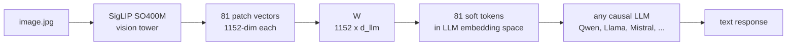
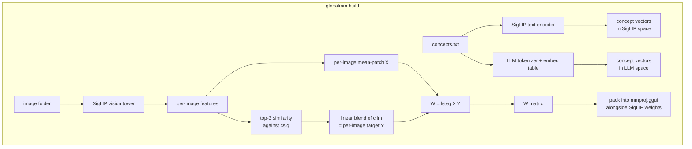

<div align="center">
  <h1>globalmm</h1>
  <p><strong>Give any local LLM vision through llama.cpp, from a matrix fit in seconds to a trained connector that draws bounding boxes</strong></p>

  <a href="https://pypi.org/project/globalmm/"></a>
  <a href="https://pypi.org/project/globalmm/"></a>
  <a href="LICENSE"></a>
</div>

<br>

`globalmm` builds an `mmproj.gguf` file that plugs into `llama.cpp` and lets a
text-only LLM accept images, and in the research also audio. Every approach keeps a frozen encoder and the
frozen LLM, and differs in the piece that connects them: how it is made, what it
costs, and what the LLM can then do.

## Approaches

| | Matrix | Connector | Connector + donor | Audio connector |
|---|---|---|---|---|
| Where | package, `--method lstsq` (default) | package, `--method connector` | research | research |
| Encoder (frozen) | SigLIP SO400M | vision tower of an existing mmproj (tested: Qwen3.8) | Qwen3-VL-2B vision tower + its first 4 LLM layers | Whisper-large-v3-turbo encoder |
| Middle piece | one matrix `W` (1152 × d) | small network, 30.7M params | small network, 16.8M params | small network, 46.1M params |
| How it is made | least squares, seconds on CPU | trained through the frozen LLM, about 3 GPU-hours | same, about 3.5 GPU-hours | same, about 3 GPU-hours |
| What the LLM can do | name what is in the image | boxes, object lists, one-sentence captions | same, more accurate | transcribe speech, name sounds, give timestamps |
| Held-out result (Llama-3.2-1B) | n/a | "Where is the X?" Acc@0.5 74% | 86% (Qwen3-VL-2B itself: 91%) | speech WER 5.3% |
| Runs in llama.cpp | yes | yes | not yet (PyTorch only) | yes |

- **Matrix.** A single 1152×D matrix maps SigLIP's patch vectors into the LLM's
  embedding space. It is fit in closed form against concept words, so it needs
  no gradient descent, no GPU and no paired image-caption data. The LLM gets a
  rough idea of *what* is in the image, with no sense of where. See
  [How the matrix method works](#how-the-matrix-method-works).
- **Connector.** Keeps the vision tower of an existing mmproj and trains a new
  projector for your LLM on COCO, with gradients flowing through the frozen LLM.
  One token per image patch keeps the layout, so the LLM learns to answer with
  bounding boxes. See [Training a connector](#training-a-connector-for-bounding-boxes).
- **Connector + donor.** Also copies the first 4 language-model layers of a
  real vision-language model in front of the connector. Their attention lets
  every image token use context from the rest of the image, which raises
  accuracy from 74% to 86% with identical training. llama.cpp cannot run those
  layers inside an mmproj yet.
- **Audio connector.** The same recipe with Whisper's encoder gives the LLM
  speech transcription and sound-event timestamps.

The results, with interactive examples, audio clips and charts, are in the
[blog post](https://zainraisan.com/blog/borrowed-senses/). The full write-up with methods and every number is in
[`research/README.md`](research/README.md).

## Quick start

Install with [uv](https://github.com/astral-sh/uv):

```bash
uv tool install globalmm
```

Or run it once without installing:

```bash
uvx globalmm build --llm ... --concepts ... --out ...
```

**Matrix** (seconds, CPU). You need a target LLM (any Hugging Face causal LM
with a standard embedding table) and a list of concept words for the visual
domain you care about, one word per line. An example covering everyday
COCO-style objects lives in `data/concepts.txt`.

```bash
globalmm build \
    --llm Qwen/Qwen2.5-1.5B-Instruct \
    --concepts data/concepts.txt \
    --out qwen.gguf
```

First run takes a few minutes because it downloads COCO val2017 (about 800 MB)
to `./.globalmm/images/` and runs a one-time SigLIP encoding pass. Later runs
reuse the cache and finish in about thirty seconds. To use your own images
instead of COCO, point `--images` at any folder of JPEGs or PNGs.

**Connector** (hours, NVIDIA GPU with about 8 GB). You need an existing mmproj
whose vision tower you want to keep and the target LLM:

```bash
globalmm build --method connector \
    --mmproj mmproj-Qwen3.8-Flash-Next-Q8_0.gguf \
    --llm meta-llama/Llama-3.2-1B-Instruct \
    --out llama-grounding.gguf
```

Details are in [Training a connector](#training-a-connector-for-bounding-boxes).

## Running inference with llama.cpp

Once you have `qwen.gguf` (the mmproj) and an existing `qwen2.5-1.5b.gguf`
(the regular LLM weights), llama.cpp handles the rest:

```bash
llama-mtmd-cli \
    -m qwen2.5-1.5b.gguf \
    --mmproj qwen.gguf \
    --image cat.jpg \
    -p "Describe what you see."
```

Or through the OpenAI-compatible server:

```bash
llama-server -m qwen2.5-1.5b.gguf --mmproj qwen.gguf --port 8080
```

Inference runs entirely in llama.cpp and needs neither Python, transformers nor a GPU.

## Training a connector for bounding boxes

`--method connector` keeps the vision tower of an existing mmproj, replaces its
projector with one trained for your LLM, and writes a new mmproj. The tower and
the LLM stay frozen. The new projector has the same shape and type as the old
one, so llama.cpp loads the result without changes.

```bash
globalmm build --method connector \
    --mmproj mmproj-Qwen3.8-Flash-Next-Q8_0.gguf \
    --llm meta-llama/Llama-3.2-1B-Instruct \
    --out llama-grounding.gguf
```

Training uses COCO train2017. On first run `globalmm` downloads the annotations
(about 250 MB) and the 118k images, shrunk to 448 pixels on arrival (about
4 GB), into `./.globalmm/coco/`. If you already have the train2017 images, pass
`--coco-images DIR` to skip the download. Each example asks the LLM to list the
objects with boxes, to find one object, or to describe the image in one
sentence, and only the projector is updated.

Requirements and cost:

- an NVIDIA GPU with about 8 GB of memory for a 1B LLM (larger LLMs need more);
- about 3 hours for one pass over COCO with a 1B LLM on a laptop RTX 3070;
- the GGUF of the same LLM, for running the result in llama.cpp.

Training saves a checkpoint every 200 steps in `.globalmm/runs/<out name>/`.
Running the same command again resumes from it. `--train-images N` and
`--steps N` give a shorter run.

Then ask for boxes:

```bash
llama-server -m Llama-3.2-1B-Instruct-Q8_0.gguf --mmproj llama-grounding.gguf \
    -c 4096 --image-max-tokens 256
```

```
Where is the dog? Answer with bounding boxes.
-> [312,402,655,890]
List the objects in this image with their bounding boxes.
-> person [437,83,785,900]
   skis [294,822,915,941]
```

Boxes are `[x1,y1,x2,y2]` on a 0-999 scale relative to the image. Results are
best with images resized so the longest side is 448 pixels, as in training.

Supported mmproj types (`clip.projector_type`):

| Type | Models | Status |
|---|---|---|
| `qwen3vl_merger` | Qwen3-VL and Qwen3.5-style vision towers | tested with the Qwen3.8 mmproj; DeepStack layers are dropped because a text-only LLM cannot use them |

Other projector types (Gemma 3, LLaVA-style and more) are planned. The
[research notes](research/README.md) describe how this method was developed and
evaluated, including a variant that adds layers from a donor vision-language
model.

## How the matrix method works



SigLIP (left of `W`) and your LLM (right of `W`) both stay frozen. `W` is the
only part `globalmm` computes, and at runtime it costs one matrix
multiplication.

SigLIP and any causal LLM both speak dense vectors, just
in different spaces. SigLIP encodes an image into 81 patch vectors of dimension
1152. An LLM expects token embeddings of its own hidden size. A linear map `W`
with shape (1152, d_llm) is enough to bridge the two, provided we can produce
paired samples to fit it against.



Step by step:

1. Encode each concept word twice. Once through SigLIP's text encoder, which
   puts words and images into the same vector space (SigLIP was trained so
   that a picture of a cat and the word "cat" end up near each other). Once
   through the target LLM's embedding table, which gives the LLM's own
   internal vector for each word.
2. For each image in the cache, take the SigLIP image vector and compute
   cosine similarity against every concept in SigLIP space. Pick the top three.
3. Blend the corresponding LLM embeddings with weights proportional to those
   similarities. This is the image's target `Y`.
4. Take the per-image mean of SigLIP's 81 patch vectors as the input `X`.
5. Cap the number of images per primary concept at fifty so the COCO
   distribution does not dominate `W`.
6. Solve `W = lstsq(X, Y)`. The whole step takes under a second on CPU.

At inference the mmproj embeds SigLIP's weights plus `W` in a single `.gguf`
file. llama.cpp loads it through the gemma3 projector path, runs SigLIP on the
input image, multiplies the 81 patch vectors by `W`, and splices the result
into the prompt wherever the image token sits.

## Why this works at all

SigLIP already knows how to match images to words. It was trained on millions
of image and caption pairs until similar things landed close together in its
vector space. That means the top three nearest concepts for any image are
already a decent guess at what is in the picture. We use those three words
to describe the image in the LLM's own vocabulary, then solve for one matrix
that turns SigLIP image vectors into something that looks like those
descriptions. Because we fit on average image vectors, the same matrix also
works when applied to individual patches at run time, which gives the LLM
a small set of soft tokens that point toward the content of the image.

This reuses the work SigLIP already did, and it is much weaker than a vision
model trained end to end. In exchange, building a projector for a new LLM takes
seconds, where training one would take hours or days on a GPU.

## Limitations of the matrix method

1. **Per-LLM.** `W` is tied to a specific LLM's embedding table. Swapping LLMs
   means rebuilding the mmproj, which is fast and takes one CLI command.
2. **Concept list matters.** `globalmm` can only describe things that appear
   in the concept list, so for medical scans you would put medical terms in
   `concepts.txt`, and for car parts a list of car parts. The default example
   file covers everyday objects only.
3. **Tokenizer BPE artifacts.** Words that split into multiple subword tokens
   such as `giraffe` (into `gir` and `affe`) are harder to recover. They end
   up as averaged fragments and the LLM may or may not put them back together.
4. **Gemma3 projector only.** The mmproj uses the `clip.projector_type=gemma3`
   metadata key because that is the only linear single-matrix projector
   llama.cpp ships. Any LLM that llama.cpp supports will work, but the target
   LLM's hidden size has to match the `projection_dim` in the mmproj, which is
   why the projector is per-LLM.
5. **SigLIP is frozen.** If SigLIP fails to see something in the image, no
   projector can recover it. State-of-the-art quality still needs proper
   multimodal training.

The connector has its own limits: it was trained on COCO's 80 object
categories, so objects outside them are found much less often (21% instead of
74% in the research runs), and three prompt templates make it answer most
questions with boxes. The [research notes](research/README.md#10-limitations)
list these in detail.

## Research

[`research/`](research/README.md) holds the experiments behind the connector
method and the two designs that are not in the package yet, connector + donor
and the audio connector. It also covers why closed-form mappings fail on image
tokens, where trained tokens end up in Llama's latent space, a training-free
test of copying a vision-language model's layers, and the training budget of
every run (all on one 8 GB laptop GPU). The [blog post](https://zainraisan.com/blog/borrowed-senses/) presents the
same results with interactive examples.

## API

```python
from globalmm.projector import compute_W
from globalmm.build_mmproj import build_mmproj

W = compute_W(
    llm_name="Qwen/Qwen2.5-1.5B-Instruct",
    concepts_path="data/concepts.txt",
)
build_mmproj(W, "qwen.gguf")
```

Same result as the CLI, useful for scripting or embedding in a larger pipeline.

## References

The approach borrows from a few papers and projects:

1. Zhai et al., *Sigmoid Loss for Language Image Pre-Training*, ICCV 2023.
   [arxiv.org/abs/2303.15343](https://arxiv.org/abs/2303.15343). SigLIP is
   the frozen vision backbone. It was trained so that images and their
   matching text land in the same vector space, which is what makes the
   zero-shot concept labeling step work.
2. Moschella et al., *Relative Representations Enable Zero-Shot Latent Space
   Communication*, ICLR 2023.
   [arxiv.org/abs/2209.15430](https://arxiv.org/abs/2209.15430). The broader
   idea that two frozen embedding spaces can be linked via a fixed set of
   anchor points without joint training.
3. Smith et al., *Offline Bilingual Word Vectors, Orthogonal Transformations
   and the Inverted Softmax*, ICLR 2017.
   [arxiv.org/abs/1702.03859](https://arxiv.org/abs/1702.03859). Shows that
   you can link two separate word embedding spaces with a single matrix
   computed in closed form. The same trick is what globalmm does between
   SigLIP and the target LLM.
4. Liu et al., *Visual Instruction Tuning* (LLaVA), NeurIPS 2023.
   [arxiv.org/abs/2304.08485](https://arxiv.org/abs/2304.08485). The trained
   linear projector baseline that globalmm replaces with closed-form lstsq.
5. [ggml-org/llama.cpp](https://github.com/ggml-org/llama.cpp). The runtime
   that loads the mmproj and runs SigLIP plus W plus the LLM in a single
   process. The gemma3 projector type in `clip.cpp` is the specific
   format globalmm writes into.

## License

[MIT](LICENSE).
