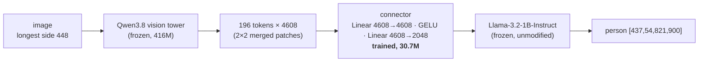
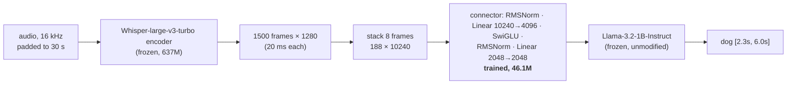

<div align="center">
  <h1>Borrowed Senses</h1>
  <p><strong>Giving a text-only LLM grounded vision and timestamped hearing<br>by training nothing but a connector</strong></p>
  <p><em>globalmm research notes · October 2026</em></p>
</div>

<br>

We take **Llama-3.2-1B-Instruct**, a model that has never seen an image or heard a sound, and give it
the ability to **point at objects in images with bounding boxes** and to **say when sounds happen in an
audio clip**. The language model is never modified. The perception comes from encoders taken from other
models: Qwen3.8's vision tower and OpenAI's Whisper encoder. The only thing we train is a small connector
between each encoder and the LLM. The result is a standard llama.cpp `mmproj.gguf` file: load it next to
the unmodified Llama GGUF and the model can see (or hear).

| | Image grounding (COCO, held out) | Audio (LibriSpeech / ESC-50, held out) |
|---|---|---|
| Frozen encoder | Qwen3.8 vision tower (416M params) | Whisper-large-v3-turbo encoder (637M) |
| Trained connector | 30.7M params (2-layer MLP) | 46.1M params (Ultravox-style SwiGLU MLP) |
| Frozen LLM | Llama-3.2-1B-Instruct | Llama-3.2-1B-Instruct |
| Headline | "Where is the X?" **Acc@0.5 74%** (no-image prior 5%) | speech **WER 5.3%**; sound events found **87%** of the time |
| Training | 3.2 h on one laptop RTX 3070 (8 GB) | 3.3 h of GPU time on the same GPU |

<p align="center"> </p>
<p align="center"><sub>Output of llama.cpp running the unmodified Llama-3.2-1B GGUF with our mmproj. In each image, the left panel answers "List the objects in this image with their bounding boxes." and the right panel answers "Where is the &lt;object&gt;?". <b>Red</b> boxes are the model's answers; <b>green</b> boxes are COCO ground truth. Images are from the held-out set.</sub></p>

---

## Contents

1. [Motivation](#1-motivation)
2. [What did not work, and why](#2-what-did-not-work-and-why)
3. [Method](#3-method)
4. [Image grounding results](#4-image-grounding-results)
5. [Audio](#5-audio)
6. [Inside the latent space after training](#6-inside-the-latent-space-after-training)
7. [Transplanting a VLM's layers instead of training](#7-transplanting-a-vlms-layers-instead-of-training)
8. [Training budget](#8-training-budget)
9. [Limitations](#9-limitations)
10. [Reproducing](#10-reproducing)

---

## 1. Motivation

`globalmm` started with a closed-form trick: map SigLIP image features into an LLM's word-embedding
space with one least-squares matrix, then ship that matrix as a llama.cpp `mmproj`. It is cheap
and needs no training, and the LLM does learn roughly *what* is in an image. It cannot learn *where*
things are, because one matrix that maps each image to a blend of word embeddings throws away the
spatial layout.

The question these notes answer is whether we can keep the parts of that idea that work and still
get **grounding**:

- the LLM stays frozen and unmodified;
- the encoder is borrowed from another model;
- the output is a drop-in llama.cpp file;
- everything runs on consumer hardware.

## 2. What did not work, and why

Two training-free attempts came before the trained connector. Both failures are informative.

**(a) Mapping Qwen's image tokens through shared word embeddings.** Qwen3.8's projector already
places image tokens in *Qwen's* embedding space. In principle, a vocabulary-to-vocabulary map
from Qwen's words to another LLM's words could then carry the image tokens across. In practice
the target model read the images as junk tokens.

**(b) The original globalmm recipe on Qwen features.** We fit one matrix from each image's mean
feature to the blended embeddings of its COCO caption words. This works for coarse recognition:
held-out label retrieval R@1 is 52%, against 0.5% chance, and the text-only model names the main
objects. It has no spatial information.

A latent-space analysis explains both results:

| Finding | Number |
|---|---|
| Qwen words ↔ Llama words are related by a **rotation** | 99.85% held-out top-1 matching of 2,000 words |
| Image tokens are **not word-like** | norm 2.16 vs 0.38 for words; ~76 effective dims vs ~790; nearest words at chance |
| …but they are **relationally aligned** with words | category RSA 0.31–0.36; image-level mutual-kNN 34% vs 3% null |
| …and **local** | 92% of token variance is within-image; visual prototypes localize objects at AUC ≈ 0.96 |
| A real VLM (Qwen3-VL-2B) names objects **only late**, **in place** | logit lens: object name in top-10 at 3% at the projector output, rising from layer 20 to 23% at layer 27 of 28, on the object's own tokens |

So image tokens carry object identity and location, but in a form the LLM only learns to read
after many layers of multimodal training. A frozen text-only LLM never had that training. This
means the translation has to happen **per token, before the LLM**, and it has to be learned. That
is the job of a trained connector.

## 3. Method



**Architecture.** The connector has exactly the shape of Qwen's own patch merger, which llama.cpp
calls `mm.0` / `mm.2`. That lets it replace the merger inside Qwen3.8's mmproj, and llama.cpp runs it
without code changes. Each 32×32-pixel region of the image becomes one LLM input vector, so spatial
layout is kept. The first layer is initialised from Qwen's merger. The second is random, scaled so
its outputs start at the norm of Llama's word embeddings.

**What is trained.** Only the connector. The vision tower and every Llama weight stay frozen. The
loss is next-token cross-entropy on the answer tokens only. Gradients flow *through* the frozen LLM
into the connector, so the connector learns to produce whatever input vectors make Llama say the
right thing. No word-embedding targets are imposed.

**Tasks** (sampled per example):

| Share | Prompt | Target |
|---|---|---|
| 45% | `List the objects in this image with their bounding boxes.` | `person [437,83,785,900]`<br>`skis [294,822,915,941]` (largest first, up to 12) |
| 35% | `Where is the {category}? Answer with bounding boxes.` | `[322,123,700,463]` (all instances, up to 6) |
| 20% | `Describe this image in one sentence.` | one of the COCO captions |

Boxes are `[x1,y1,x2,y2]` on a 0–999 scale relative to the image. They are written as plain text, so
nothing is added to Llama's vocabulary. Objects smaller than 0.4% of the image are dropped.

**Training.** Both runs used AdamW with cosine decay, batch 8, on a single RTX 3070 Laptop with 8 GB.

| Run | Data | Steps | Time | Final loss |
|---|---|---|---|---|
| run1 | 4,500 COCO val2017 images (features pre-cached) | 2,500 | 24 min | 2.21 |
| full | all 118,287 COCO train2017 images (vision tower run live in bf16), initialised from run1 | 14,800 (≈1 epoch) | 3.2 h | 2.06 |

**Deployment.** `export_mmproj.py` writes the connector weights into Qwen3.8's mmproj GGUF in place of
`mm.0`/`mm.2` and sets the projection dimension to 2048. In llama.cpp (build 4413a19) the image
embeddings match PyTorch at cosine 0.997–1.0, and the generated boxes match almost token for token.

## 4. Image grounding results

### 4.1 Setup

The test set is **192 COCO val2017 images held out from all training**: run1 never saw them, and
the full run trained on train2017 and was initialised from run1. These numbers measure
**in-distribution generalisation**: new images of the same 80 COCO object categories the connector
was trained on. Section 4.4 tests objects outside those categories.

- **Where-IoU**: for each image we ask for the largest object's category and compare the first
  returned box with the best-matching ground-truth instance of that category.
- **Acc@0.5**: the share of questions where that IoU is at least 0.5.
- **List, class-level P/R**: compares the set of category names in the answer with the categories present.
- **List, box-level P/R @0.5**: greedy one-to-one matching of predicted boxes to ground-truth boxes of the same category.

Controls and baselines:

- **Category prior**: the mean training-set box for the category. This is what an LLM could guess from the question alone.
- **Centre box**: a fixed box `[250,250,750,750]`.
- **Shuffled image**: the same question asked with *another* image's features. This measures how much comes from language priors and answer format alone.
- **Qwen3-VL-2B-Instruct**: a VLM trained end to end for grounding, given the same 448-pixel images and its native grounding prompt (JSON output, 0–1000 coordinates). This is not a fair competitor. It was trained on vast amounts of grounding data and its LLM was trained together with its vision encoder. It shows how far a frozen text-only LLM with a 30M-parameter connector is from a purpose-built model.

### 4.2 Main results

| Model | Where-IoU | Acc@0.5 | List P / R (class) | List P / R (box @0.5) |
|---|---|---|---|---|
| Centre box | 0.25 | – | – | – |
| Category prior (no image) | 0.17 | 5.2% | – | – |
| Full connector, **shuffled image** | 0.08 | 4.2% | 0.12 / 0.10 | 0.00 / 0.01 |
| run1 (4.5k images) | 0.47 | 47.9% | 0.85 / 0.80 | 0.23 / 0.25 |
| **Full (118k images)** | **0.64** | **74.0%** | **0.91 / 0.84** | **0.44 / 0.47** |
| Qwen3-VL-2B (reference, end-to-end VLM) | 0.83 | 91.1% | – | – |

<sub>Full-connector numbers are from the extended evaluation (`eval_extra.py`). An earlier run of the same evaluation gave 0.638 / 72.9%. The difference comes from bf16 GPU kernels not being bit-for-bit deterministic under greedy decoding, so treat differences of about one point as noise.</sub>

The shuffled-image control falls to the level of the no-image prior. The boxes therefore come from
the image, not from the question. Training on 26× more images raised Acc@0.5 from 48% to 74% and
nearly doubled box-level recall in lists.

### 4.3 By object size

Acc@0.5 of the "where" answer, by the queried object's area as a share of the image:

| | small (< 1%, n=9) | medium (1–10%, n=85) | large (> 10%, n=98) |
|---|---|---|---|
| run1 | 0% | 24% | 73% |
| **Full** | **22%** | **62%** | **89%** |
| Qwen3-VL-2B | 78% | 88% | 95% |

<p align="center"></p>

Most of the gain from more data went to medium-sized objects. On large objects the connector
(89%) comes within 6 points of the end-to-end VLM (95%). The gap is on small and medium objects. Small objects remain hard: each
connector token covers a 32×32-pixel cell of a 448-pixel image. With only 9 small-object questions
in the test set, the small-object number is noisy.

### 4.4 Out of distribution: objects outside COCO's 80 categories

The COCO test above asks only about the 80 categories the connector was trained on. To measure
**open-vocabulary** grounding, we used LVIS v1 annotations on the same held-out images:

- For each image, we take the largest object (at least 1% of the image) whose category is **not** a COCO category.
- COCO look-alikes are removed: categories that are COCO classes under another name ("television set", "sofa") or sub-types of one ("school bus", "polar bear", "armchair").
- That leaves **246 questions over 119 categories**, such as street sign, blanket, cabinet, curtain, mirror, jersey and desk.
- The prompt is the same "Where is the X? Answer with bounding boxes."

| Model | Where-IoU | Acc@0.5 | Acc@0.5 medium (1–10%) | Acc@0.5 large (> 10%) |
|---|---|---|---|---|
| Full connector, shuffled image | 0.05 | 2.0% | 0.6% | 5.8% |
| run1 | 0.18 | 11.4% | 3.4% | 31.9% |
| **Full** | **0.21** | **20.7%** | **12.4%** | **42.0%** |
| Qwen3-VL-2B (reference) | 0.72 | 84.6% | 80.2% | 95.7% |

<p align="center"></p>
<p align="center"><sub>Six out-of-distribution questions, picked at evenly spaced positions from the large-object subset rather than chosen by hand. <b>Green</b>: LVIS ground truth. <b>Red</b>: our connector + Llama-3.2-1B. <b>Blue</b>: Qwen3-VL-2B.</sub></p>

**Outside COCO's 80 categories, grounding mostly fails.** Acc@0.5 falls from 74% to 21%. That is
still 10× the shuffled-image control, so some signal transfers, but the hits are not evidence of
open-vocabulary grounding:

- **Hits cluster on objects that share a location with a COCO object.** Blanket (7 of the hits)
  sits where a *bed* is, desk where a *dining table* is, street sign next to a *stop sign*, and
  plate or place mat on a *dining table*. The model has learned "the region of the COCO object most
  related to this word", not the word itself.
- **Misses are not just COCO objects in disguise.** Only 19 of 195 misses box a COCO object of the
  image instead. Most boxes land in a plausible but wrong region (see "cabinet" and "soup" above).

Qwen3-VL-2B drops only from 91% to 85% on the same questions. Our vision tower was trained inside a
general VLM, and Section 2 showed that its tokens carry object identity well beyond COCO's
categories. So the most likely bottleneck is our training data, 80 category names and three prompt
templates, rather than the encoder or the frozen LLM. This is a hypothesis we have not yet tested.
Training on LVIS, RefCOCO and Visual Genome is the experiment that would test it.

### 4.5 Qualitative

<p align="center"> </p>

These two images show typical behaviour:

- **Living room.** The TV, table, chairs, plants and fridge are found. The two people and the vase are missed.
- **Bedroom.** The bed is right. The list then falls into a loop, repeating `book [737,469,822,599]`
  until the token limit.

Repetition affects 20% of list lines and 21% of list answers hit the 160-token limit. It is the main
failure mode of the list task. The "where" task does not suffer from it.

## 5. Audio

The same recipe, applied to hearing. The image task's counterpart of a bounding box is a **time
interval**: "When can you hear the dog?" → `[2.3s, 6.0s]`.

### 5.1 Method



**Architecture.** The connector has exactly the shape of llama.cpp's built-in *Ultravox* projector,
so `export_audio_mmproj.py` can write the frozen Whisper encoder and the trained connector into an
mmproj with llama.cpp's own converter. Stacking 8 Whisper frames gives one LLM token per 160 ms of
audio. A 30-second window becomes 188 tokens, about as many as an image.

**Tasks** (half speech, half sounds):

| Data | Prompt | Target |
|---|---|---|
| LibriSpeech train-clean-100 (28.5k utterances, 100 h) | `Transcribe the audio.` | `Concord returned to its place amidst the tents.` |
| ESC-50 folds 1–4 (1,600 clips, 50 classes), each clip placed alone in a 6–15 s track | `What sound is this?` | `Thunderstorm.` |
| synthetic tracks of 1–3 non-overlapping ESC-50 events, 6–25 s, random gains and noise floor | `When can you hear the {sound}? Answer with timestamps.` | `[2.3s, 6.0s]` |
| same | `List the sounds in this audio with their timestamps.` | `dog [2.0s, 6.7s]`<br>`hen [7.6s, 12.6s]` |

Event boundaries come from each clip's own energy envelope: 50 ms frames above −20 dB relative to
the clip's peak. Training ran for 8,000 steps at batch 8 (64k examples) with AdamW and lr 5e-4.

<p align="center"></p>

Unlike the image connector, the audio connector's loss stays flat for about 15k examples and then
**collapses within about 2k examples**, from 2.6 to 0.5. The connector abruptly "locks on" to a
usable mapping. In the left panel, the image loss jumps when moving from run1 to the full run
because run1 had been fitting its 4.5k images for 4.4 epochs; the new train2017 images were unseen.

### 5.2 Results

All tests are held out: LibriSpeech **test-clean** (first 300 utterances of at most 29.5 s), ESC-50
**fold 5** (400 clips never used in training), and 300 synthetic mixtures built from fold 5.

| Task | Metric | Ours | Shuffled audio | Baseline / reference |
|---|---|---|---|---|
| Speech transcription | WER ↓ | **5.3%** | 125% | Whisper-large-v3-turbo with its own decoder: 2.6% |
| Sound identification (50 classes) | accuracy | **65.7%** | 1.7% | chance: 2% |
| "When can you hear X?" | mean temporal IoU | **0.59** | 0.24 | whole-track answer: 0.32 |
| | Acc@0.5 | **64.3%** | 22.0% | whole-track answer: 13.0% |
| List sounds with timestamps | label precision / recall | **0.59 / 0.58** | 0.05 / 0.03 | |
| | events found at tIoU ≥ 0.5, label must match | **49%** | 1% | |
| | events found at tIoU ≥ 0.5, **any label** | **87%** | 32% | |

<p align="center"></p>

**Speech is close to Whisper's own decoder.** The text-only LLM transcribes at 5.3% WER through a
connector it was never trained with, about twice the error of Whisper's purpose-built 4-layer
decoder. 161 of the 300 utterances are transcribed perfectly. Most errors are substitutions (244 of
338 word errors), such as "assurances" → "assurance" and names ("Hans stirs not" → "Han stresses not").
WER is 3.6% on the shorter half of utterances and 5.8% on the longer half, where the 1B model
occasionally repeats a clause.

**Finding events is easy; naming the right one is hard.** Listing recovers 87% of events with a
correct time span regardless of label, against 32% for shuffled audio. With the label required it
is 49%. The "when" question shows the same thing, broken down by the number of events in the clip:

| Events in clip | 1 | 2 | 3 |
|---|---|---|---|
| "When can you hear X?" Acc@0.5 | 96% | 47% | 40% |

With one event the model is nearly perfect. With several it usually returns the span of *an* event,
often the first one, not the one asked about. Identification errors are mostly between acoustically
similar classes: coughing→sneezing, frog→dog, pig→cow, mouse click→keyboard typing, insects→chainsaw.

**In llama.cpp.** The exported mmproj loads in a current llama.cpp. On 13 held-out test clips, 9
answers are identical to PyTorch, including all transcriptions and single-sound answers. The other
4 are three-event lists. There, small numeric differences (Q8_0 LLM and f16 encoder in llama.cpp,
bf16 in PyTorch) shift a timestamp or the bracket style, and in one case caused a repetition
("dog dog dog [4.7s, 9.2s]"). The shuffled-audio WER above 100% is not a bug: given the wrong audio,
the model confidently transcribes a different, often longer sentence.

## 6. Inside the latent space after training

Where do the tokens end up once the connectors are trained? `latent_blog.py` compares, on 80 held-out
COCO images (labelled by COCO masks) and 70 held-out audio clips:

- Qwen3.8's own projector output with Qwen's words;
- the trained connector's output with Llama's words;
- the naive route of rotating Qwen's image tokens with the Qwen→Llama word rotation.

| Tokens | Mean length | Word vectors' length | Object name in 10 nearest words | Shuffled names | Object-vs-rest similarity to its word (AUC) |
|---|---|---|---|---|---|
| Qwen projector output · Qwen words | 2.21 | 0.41 | 0.1% | 0.2% | 0.48 |
| Naive word rotation · Llama words | 2.41 | 0.95 | 0.0% | 0.0% | – |
| **Vision connector · Llama words** | **23.1** | 0.95 | **2.6%** | 0.1% | **0.63** (119 objects) |
| **Audio connector · Llama words** | **92.0** | 0.95 | 0.0% | 0.0% | – |

**The trained connectors do not turn tokens into words.** Image tokens end up 24× and audio tokens
96× longer than Llama's word vectors. They point in directions no word uses, and their nearest words
are arbitrary ("asn", "cited", "moderate"). Llama still reads them: each layer normalises its input
before using it, so direction matters more than length. Training found directions the frozen
layers respond to.

**There is a faint pull toward meaning.** Within an image, an object's Qwen tokens are no more
similar to the object's word than background tokens are (AUC 0.48). After the connector, they are
modestly more similar to Llama's word for the object (AUC 0.63).

In a shared 2D projection, Llama's words, the vision tokens and the audio tokens occupy three
separate regions.

## 7. Transplanting a VLM's layers instead of training

An alternative to training a connector is to borrow more of a real vision-language model. The VLM's
own LLM layers were trained to read its projector output. So we copy its first *k* layers, frozen, and
add one untrained transformation step into the target LLM's input space. `bridge_test.py` tests this
with Qwen3-VL-2B as the donor. Its vision tower and first *k* LLM layers are used, including the
DeepStack visual injections into layers 0–2. The target is the unmodified Llama-3.2-1B. Each image's
tokens go through the donor alone (image tokens only, causal), then through one of two
transformation steps:

- **A, rotation:** the orthogonal Procrustes map between the two word-embedding tables, fitted on
  24k shared words with top-1 1.00 on the fit set, applied to the hidden states. Each vector is rescaled
  to Llama's mean word-embedding length.
- **B, decode and re-embed:** Qwen's final norm and output head decode each image token into its top-5
  Qwen tokens. These are mapped to Llama tokens with the identical BPE string (110k of 152k tokens
  match), and Llama receives the probability-weighted average of their Llama embeddings.

Llama is asked "What objects are in this image? Answer with a short list." on 100 held-out COCO
images. We count which COCO categories it names, matching synonyms such as man → person and
sofa → couch. Recall is over categories covering at least 1% of the image.

| Condition | Recall | Precision |
|---|---|---|
| No image | 0% | – |
| A, rotation, k = 0, 1, 2, 4, 12, 20, 24, 28 | 0–4% at every k | – |
| B, decode, k = 0 | 14% | 39% |
| B, decode, k = 1 | 23% | 40% |
| B, decode, k = 2 / 4 / 12 / 20 | 6% / 11% / 21% / 20% | 14–34% |
| B, decode, k = 24 | 45% | 49% |
| B, decode, k = 28 (every donor layer) | 50% | 54% |
| Qwen3-VL-2B answering itself | 83% | 63% |
| Trained connector (Section 3, same question) | 87% | 81% |

**The rotation fails at every depth.** It only aligns the input word tables. Hidden states of image
tokens are not word-shaped (Section 6), so the rotation sends them to meaningless inputs, and Llama
produces gibberish ("## of a = a = 0").

**Decode-and-re-embed works partially, without any training, and with an open vocabulary.** Because
Llama receives real word embeddings, it understands them. For the skier image, 1 copied layer gives
"Goggles, Ski, Pants, Boots, Helmet" and 28 layers give "Ski poles, Goggles, Sunglasses, Striped scarf".
Those are objects outside COCO's 80 categories, where the trained connector fails (Section 4.4). The
COCO-only score above undercounts this. The quality is not monotonic in *k*: it follows the logit
lens, with a small bump after layer 1, a dip through the middle layers, and most of the gain from
layer 24 onward. The good settings therefore use most of the donor's 1.7B-parameter LLM.

Two limits remain:
- Words carry no coordinates, so this route cannot produce boxes.
- The decode step uses a 152k-way output head with top-k selection, which llama.cpp's mmproj graph
  cannot express today.

The next experiment is a **hybrid**: feed Llama both the decoded-word tokens from 1–2 donor layers
(open-vocabulary *what*) and the trained connector's tokens (*where*), and retrain the connector with
both present.

## 8. Training budget

All runs used one RTX 3070 Laptop GPU (8 GB) and a 13.8 GB-RAM machine that stayed in normal use.

| Run | Data | Steps × batch | GPU time | Wall clock | Peak VRAM | Trained / frozen params |
|---|---|---|---|---|---|---|
| Vision, run1 | 4.5k COCO images (features cached once) | 2,500 × 8 | 24 min | 24 min | 5.3 GB | 30.7M / 1.65B |
| Vision, full | 118k COCO images (encoder run live) | 14,800 × 8 | 3 h 15 min | 3 h 15 min | 6.1 GB | 30.7M / 1.65B |
| Audio | 100 h LibriSpeech + 1.6k ESC-50 clips | 8,000 × 8 | ≈3 h 15 min | 6 h 46 min | 6.2 GB | 46.1M / 1.87B |

That is about 7 GPU-hours of training plus about 1.5 hours of evaluation. The audio run's wall
clock is longer because the RAM watchdog paused it whenever free memory fell below 750 MB. The
connectors make up 1.8% (vision) and 2.4% (audio) of each pipeline's parameters.

## 9. Limitations

- **Closed vocabulary.** Grounding was trained only on COCO's 80 categories with three prompt
  templates. Outside them, Acc@0.5 falls from 74% to 21% (Section 4.4). The model also over-learned
  the answer format: "What colour is her jacket?" gets a bounding box instead of "red". Audio has the
  same limit: 50 ESC-50 sound classes.
- **Repetition in long lists.** Greedy decoding loops on scenes with many similar objects.
- **Small objects.** Acc@0.5 is 22% for objects under 1% of the image.
- **Binding in audio.** With several sounds in a clip, "when is X" often returns another event's span.
- **Synthetic audio scenes.** Timestamp tasks use artificial mixtures of non-overlapping clips. Real
  recordings with overlapping sounds would be harder.
- **Small LLM.** A 1B model limits what can be said about an image, beyond where things are.
- **Evaluation size.** 192 images (COCO), 246 questions (LVIS) and 300 clips per audio test, so differences of a few points are within noise.
- **Single seed.** Each configuration was trained once.

Planned next steps:

- train on LVIS (1,203 categories, same images), RefCOCO and Visual Genome, so grounding works for more than COCO's categories;
- mix in VQAv2 so ordinary questions get ordinary answers;
- deduplicate list targets to stop repetition;
- for audio, train on real recordings with overlapping sounds (AudioSet / AudioCaps) and on many-event clips, to fix label-to-segment binding;
- train a connector for a second LLM family to support the "any model" claim.

## 10. Reproducing

The scripts are copied into [`code/`](code/). They expect the workspace layout of `.globalmm/`:
`scripts/`, `dl/` for models, `coco/`, `audio/` and `analysis/`.

All scripts are in `.globalmm/scripts/`. Heavy jobs run inside memory-capped `systemd-run` scopes
with a RAM/temperature watchdog. That is how 3+ hour runs completed on an 8 GB laptop GPU while
the machine stayed in normal use.

```bash
# image grounding
python prep_coco_train.py && python fetch_coco_train.py ../coco/train448   # 118k images, resized on arrival
python train_connector.py train --steps 2500 --tag run1                      # run1 (val2017 features)
python train_full.py --steps 14800 --lr 2e-4 --init run1 --tag run_full     # full run
python train_connector.py eval --tag run_full && python eval_extra.py run_full run1
python export_mmproj.py ../analysis/grounding/run_full/connector.pt \
       ../dl/mmproj-Qwen3.8-Flash-Next-Q8_0.gguf ../dl/mmproj-qwen38-grounding-llama32-1b-full.gguf
python prep_lvis.py && python eval_ood.py run_full run1                     # out-of-distribution test
python eval_qwen3vl.py coco && python eval_qwen3vl.py lvis                  # reference VLM

# audio (Whisper-large-v3-turbo, LibriSpeech clean parquet from the HF mirror, ESC-50)
python prep_audio.py                                                         # ESC-50 -> 16 kHz + event extents
python train_audio.py train --steps 8000 --tag a1
python train_audio.py eval --tag a1 && python eval_whisper_ref.py 300
python export_audio_mmproj.py ../analysis/audio/a1/connector.pt ../dl/mmproj-whisper-audio-llama32-1b.gguf
python make_figures.py
python latent_blog.py                                                        # latent-space measurements
python bridge_test.py qwen && python bridge_test.py llama                    # layer-transplant test
```

**Using it.** You need a current llama.cpp. An older build (9940) gave visibly degraded vision output.

```bash
llama-server -m Llama-3.2-1B-Instruct-Q8_0.gguf \
  --mmproj mmproj-qwen38-grounding-llama32-1b-full.gguf -c 4096 --image-max-tokens 256
```

Then ask `List the objects in this image with their bounding boxes.` or
`Where is the dog? Answer with bounding boxes.` For best results, resize images so the longest side
is 448 and both sides are multiples of 32, as in training.

For audio, swap the mmproj. The language model file stays the same:

```bash
llama-server -m Llama-3.2-1B-Instruct-Q8_0.gguf \
  --mmproj mmproj-whisper-audio-llama32-1b.gguf -c 4096
```

Send a WAV as `input_audio` and ask `Transcribe the audio.`, `What sound is this?`,
`When can you hear the dog? Answer with timestamps.` or
`List the sounds in this audio with their timestamps.` Training used clips of up to 30 s. llama.cpp splits longer audio into 30 s windows, which we have not tested.
