<div align="center">
  <h1>Borrowed Senses</h1>
  <p><strong>Giving a text-only LLM bounding boxes for images and timestamps for sounds<br>by training a small connector</strong></p>
  <p><em>globalmm research notes, October 2026</em></p>
  <p><a href="https://zainraisan.com/blog/borrowed-senses/">Blog version</a> with interactive examples, audio clips and charts</p>
</div>

<br>

These notes start from **Llama-3.2-1B-Instruct**, a model that has never seen an image or heard a
sound. We give it two new skills: **pointing at objects in images with bounding boxes** and **saying
when sounds happen in an audio clip**. Llama's weights are never changed. The perception comes from
encoders taken from other models (Qwen3.8's vision tower and OpenAI's Whisper encoder), and the only
part we train is a small connector between each encoder and the LLM. The result is a standard
llama.cpp `mmproj.gguf` file that loads next to the unmodified Llama GGUF.

| | Image grounding (COCO, held out) | Audio (LibriSpeech / ESC-50, held out) |
|---|---|---|
| Frozen encoder | Qwen3.8 vision tower (416M params) | Whisper-large-v3-turbo encoder (637M) |
| Trained connector | 30.7M params (2-layer MLP) | 46.1M params (Ultravox-style SwiGLU MLP) |
| Frozen LLM | Llama-3.2-1B-Instruct | Llama-3.2-1B-Instruct |
| Headline | "Where is the X?" **Acc@0.5 74%** (no-image prior 5%) | speech **WER 5.3%**; sound events found **87%** of the time |
| Training | 3.2 h on one laptop RTX 3070 (8 GB) | 3.3 h of GPU time on the same GPU |

<p align="center">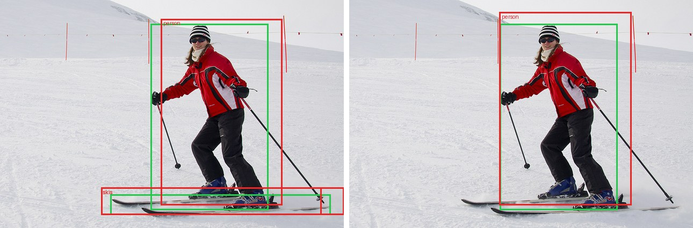 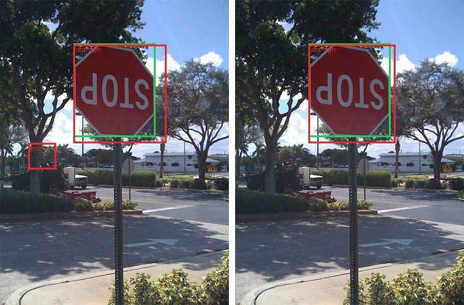</p>
<p align="center"><sub>Output of llama.cpp running the unmodified Llama-3.2-1B GGUF with our mmproj. In each image, the left panel answers "List the objects in this image with their bounding boxes." and the right panel answers "Where is the &lt;object&gt;?". <b>Red</b> boxes are the model's answers and <b>green</b> boxes are COCO ground truth. Images are from the held-out set.</sub></p>

The best image result comes from a second design, **connector + donor** (Section 8). We copy
Qwen3-VL-2B's vision tower together with its first 4 language-model layers, keep them frozen, and
train a 16.8M-parameter connector after them. With the same data and schedule as the plain
connector, held-out COCO "where is X?" Acc@0.5 goes from **74.0% to 85.9%** (Qwen3-VL-2B itself
scores 91.1%), and objects outside COCO go from 21.5% to 28.0%. This design runs in PyTorch for now,
because llama.cpp cannot run language-model layers inside an mmproj.

---

## Contents

1. [Motivation](#1-motivation)
2. [What did not work, and why](#2-what-did-not-work-and-why)
3. [Method](#3-method)
4. [Image grounding results](#4-image-grounding-results)
5. [Audio](#5-audio)
6. [Inside the latent space after training](#6-inside-the-latent-space-after-training)
7. [Transplanting a VLM's layers without training](#7-transplanting-a-vlms-layers-without-training)
8. [Connector + donor: copy a VLM's first layers, then train a connector](#8-connector--donor-copy-a-vlms-first-layers-then-train-a-connector)
9. [Training budget](#9-training-budget)
10. [Limitations](#10-limitations)
11. [Reproducing](#11-reproducing)

---

## 1. Motivation

`globalmm` started with a closed-form method. It maps SigLIP image features into an LLM's
word-embedding space with one least-squares matrix and ships that matrix as a llama.cpp `mmproj`.
Building it is cheap and needs no training, and the LLM learns roughly what is in an image. It
cannot learn where things are, because the matrix is fit from each image's average feature to a
blend of word embeddings, and that average has no spatial layout.

These notes ask whether grounding is possible while keeping the rest of the setup:

- the LLM stays frozen and unmodified;
- the encoder is borrowed from another model;
- the output is a llama.cpp file that loads without code changes;
- everything runs on consumer hardware.

## 2. What did not work, and why

We tried two training-free methods before the trained connector.

**(a) Mapping Qwen's image tokens through shared word embeddings.** Qwen3.8's projector already
places image tokens in Qwen's embedding space. A vocabulary-to-vocabulary map from Qwen's words to
another LLM's words could, in principle, carry the image tokens across. When we tried it, the target
model read the images as junk tokens.

**(b) The original globalmm recipe on Qwen features.** We fit one matrix from each image's mean
feature to the blended embeddings of its COCO caption words. Coarse recognition works: held-out label
retrieval R@1 is 52% against 0.5% chance, and the text-only model names the main objects. The output
carries no spatial information.

A latent-space analysis accounts for both results:

| Finding | Number |
|---|---|
| Qwen's and Llama's word embeddings are related by a **rotation** | 99.85% held-out top-1 matching of 2,000 words |
| Image tokens do **not look like words** | norm 2.16 vs 0.38 for words; about 76 effective dims vs about 790; nearest words at chance |
| Image tokens still **relate to each other the way words do** | category RSA 0.31-0.36; image-level mutual-kNN 34% vs 3% null |
| Image tokens are **local** | 92% of token variance is within-image; visual prototypes localize objects at AUC 0.96 |
| A real VLM (Qwen3-VL-2B) names objects **late** and **at the object's own tokens** | logit lens: object name in the top 10 for 3% of tokens at the projector output, rising from layer 20 to 23% at layer 27 of 28 |

Image tokens carry object identity and location, in a form that an LLM learns to read only after
many layers of multimodal training. A frozen text-only LLM never had that training, so the
translation has to be learned and has to happen per token, before the LLM. A trained connector does
that.

## 3. Method

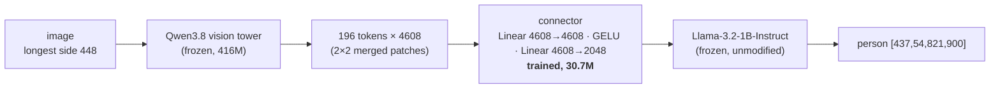

**Architecture.** The connector has the same shape as Qwen's own patch merger, which llama.cpp calls
`mm.0` / `mm.2`. It can therefore replace the merger inside Qwen3.8's mmproj, and llama.cpp runs it
without code changes. Each 32×32-pixel region of the image becomes one LLM input vector, which keeps
the spatial layout. The first layer starts from Qwen's merger weights. The second starts random,
scaled so its outputs match the size of Llama's word embeddings.

**What is trained.** Only the connector. The vision tower and every Llama weight stay frozen. The
loss is next-token cross-entropy on the answer tokens. Gradients flow through the frozen LLM into
the connector, so the connector learns whatever input vectors make Llama give the right answer. We
never tell it which vectors to produce.

**Tasks** (one picked at random per example):

| Share | Prompt | Target |
|---|---|---|
| 45% | `List the objects in this image with their bounding boxes.` | `person [437,83,785,900]`<br>`skis [294,822,915,941]` (largest first, up to 12) |
| 35% | `Where is the {category}? Answer with bounding boxes.` | `[322,123,700,463]` (all instances, up to 6) |
| 20% | `Describe this image in one sentence.` | one of the COCO captions |

Boxes are `[x1,y1,x2,y2]` on a 0-999 scale relative to the image. They are written as plain text, so
nothing is added to Llama's vocabulary. Objects smaller than 0.4% of the image are dropped.

**Training.** Both runs used AdamW with cosine decay and batch 8 on a single RTX 3070 Laptop GPU
with 8 GB.

| Run | Data | Steps | Time | Final loss |
|---|---|---|---|---|
| run1 | 4,500 COCO val2017 images (features pre-cached) | 2,500 | 24 min | 2.21 |
| full | all 118,287 COCO train2017 images (vision tower run live in bf16), initialised from run1 | 14,800 (about 1 epoch) | 3.2 h | 2.06 |

**Deployment.** `export_mmproj.py` writes the connector weights into Qwen3.8's mmproj GGUF in place
of `mm.0`/`mm.2` and sets the projection dimension to 2048. In llama.cpp (build 4413a19) the image
embeddings match PyTorch at cosine 0.997-1.0, and the generated boxes match almost token for token.

## 4. Image grounding results

### 4.1 Setup

The test set is **192 COCO val2017 images held out from all training**. run1 never saw them, and the
full run trained on train2017 after starting from run1. These numbers measure generalisation to new
images of the same 80 COCO categories the connector was trained on. Section 4.4 tests objects
outside those categories.

- **Where-IoU**: for each image we ask for the largest object's category and compare the first
  returned box with the best-matching ground-truth instance of that category.
- **Acc@0.5**: the share of questions where that IoU is at least 0.5.
- **List, class-level P/R**: compares the set of category names in the answer with the categories present.
- **List, box-level P/R @0.5**: greedy one-to-one matching of predicted boxes to ground-truth boxes of the same category.

Controls and baselines:

- **Category prior**: the mean training-set box for the category, which is what an LLM could guess from the question alone.
- **Centre box**: a fixed box `[250,250,750,750]`.
- **Shuffled image**: the same question asked with another image's features. This measures how much comes from language priors and the answer format.
- **Qwen3-VL-2B-Instruct**: a VLM trained end to end for grounding, given the same 448-pixel images and its native grounding prompt (JSON output, 0-1000 coordinates). It was trained on large amounts of grounding data, with its LLM and vision encoder trained together, so it is a reference point for what a purpose-built model reaches. It is not a fair competitor.

### 4.2 Main results

| Model | Where-IoU | Acc@0.5 | List P / R (class) | List P / R (box @0.5) |
|---|---|---|---|---|
| Centre box | 0.25 | n/a | n/a | n/a |
| Category prior (no image) | 0.17 | 5.2% | n/a | n/a |
| Full connector, **shuffled image** | 0.08 | 4.2% | 0.12 / 0.10 | 0.00 / 0.01 |
| run1 (4.5k images) | 0.47 | 47.9% | 0.85 / 0.80 | 0.23 / 0.25 |
| **Full (118k images)** | **0.64** | **74.0%** | **0.91 / 0.84** | **0.44 / 0.47** |
| Qwen3-VL-2B (reference, end-to-end VLM) | 0.83 | 91.1% | n/a | n/a |

<sub>Full-connector numbers are from the extended evaluation (`eval_extra.py`). An earlier run of the same evaluation gave 0.638 / 72.9%. bf16 GPU kernels are not bit-for-bit deterministic under greedy decoding, so differences of about one point are noise.</sub>

With a shuffled image the score drops to the level of the no-image prior, so the boxes come from the
image and not from the question. Training on 26 times more images raised Acc@0.5 from 48% to 74% and
nearly doubled box-level recall in lists.

### 4.3 By object size

Acc@0.5 of the "where" answer, by the queried object's area as a share of the image:

| | small (< 1%, n=9) | medium (1-10%, n=85) | large (> 10%, n=98) |
|---|---|---|---|
| run1 | 0% | 24% | 73% |
| **Full** | **22%** | **62%** | **89%** |
| Qwen3-VL-2B | 78% | 88% | 95% |

<p align="center">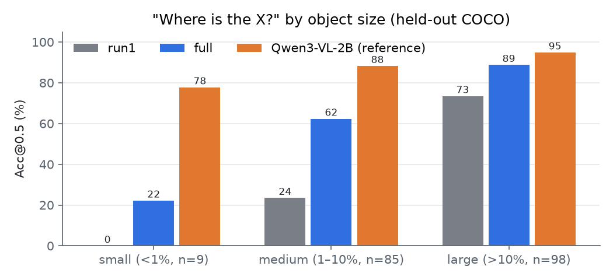</p>

Most of the gain from more data went to medium-sized objects. On large objects the connector (89%)
is within 6 points of the end-to-end VLM (95%), and the remaining gap is on small and medium
objects. Small objects are hard because each connector token covers a 32×32-pixel cell of a
448-pixel image. There are only 9 small-object questions, so that number is noisy.

### 4.4 Out of distribution: objects outside COCO's 80 categories

The COCO test only asks about the 80 categories the connector was trained on. To measure
open-vocabulary grounding we used LVIS v1 annotations on the same held-out images:

- For each image, we take the largest object (at least 1% of the image) whose category is not a COCO category.
- We remove COCO look-alikes: categories that are COCO classes under another name ("television set", "sofa") or sub-types of one ("school bus", "polar bear", "armchair").
- That leaves **246 questions over 119 categories**, such as street sign, blanket, cabinet, curtain, mirror, jersey and desk.
- The prompt is the same "Where is the X? Answer with bounding boxes."

| Model | Where-IoU | Acc@0.5 | Acc@0.5 medium (1-10%) | Acc@0.5 large (> 10%) |
|---|---|---|---|---|
| Full connector, shuffled image | 0.05 | 2.0% | 0.6% | 5.8% |
| run1 | 0.18 | 11.4% | 3.4% | 31.9% |
| **Full** | **0.21** | **20.7%** | **12.4%** | **42.0%** |
| Qwen3-VL-2B (reference) | 0.72 | 84.6% | 80.2% | 95.7% |

<p align="center">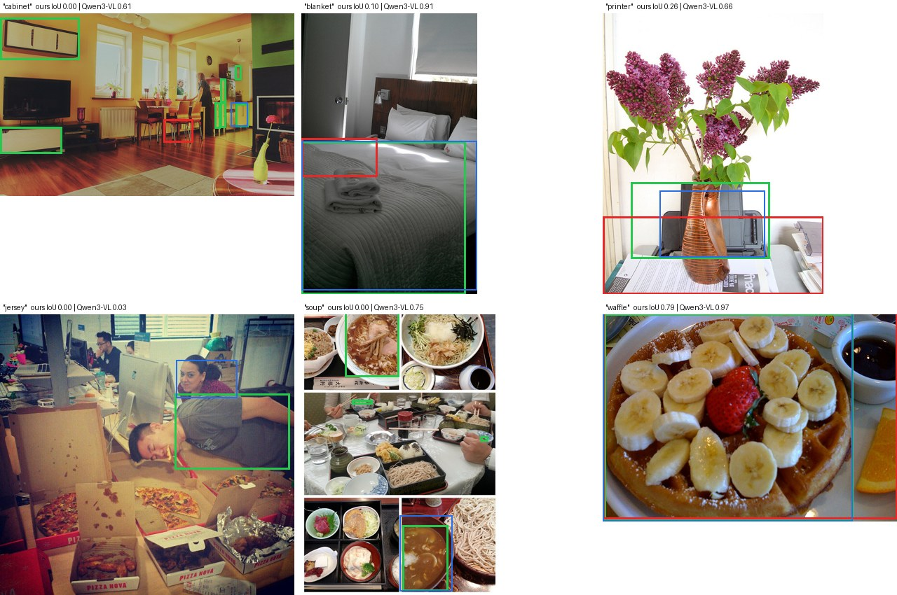</p>
<p align="center"><sub>Six out-of-distribution questions, picked at evenly spaced positions from the large-object subset. <b>Green</b>: LVIS ground truth. <b>Red</b>: our connector + Llama-3.2-1B. <b>Blue</b>: Qwen3-VL-2B.</sub></p>

Outside COCO's 80 categories, grounding mostly fails. Acc@0.5 falls from 74% to 21%. That is still
10 times the shuffled-image control, so some signal transfers, but the hits do not show
open-vocabulary grounding:

- The hits cluster on objects that share a location with a COCO object. Blanket (7 of the hits) sits
  where a bed is, desk where a dining table is, street sign next to a stop sign, and plate or place
  mat on a dining table. The model has learned to find the region of the most related COCO object.
- Most misses land somewhere else. Only 19 of 195 misses box a COCO object in the image. Most boxes
  land in a plausible but wrong region (see "cabinet" and "soup" above).

Qwen3-VL-2B drops only from 91% to 85% on the same questions. Our vision tower was trained inside a
general VLM, and Section 2 showed that its tokens carry object identity well beyond COCO's
categories. The most likely bottleneck is our training data, with 80 category names and three prompt
templates. We have not tested this yet. Training on LVIS, RefCOCO and Visual Genome would test it.

### 4.5 Qualitative

<p align="center">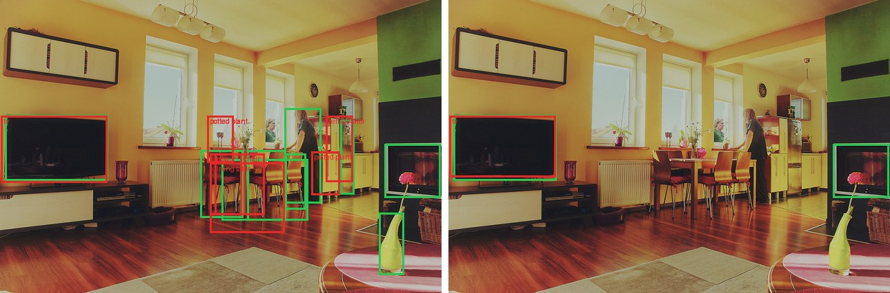 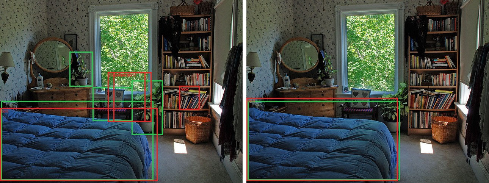</p>

In the living room the model finds the TV, table, chairs, plants and fridge, and misses the two
people and the vase. In the bedroom it gets the bed right, then the list falls into a loop and
repeats `book [737,469,822,599]` until the token limit.

Repetition affects 20% of list lines, and 21% of list answers hit the 160-token limit. It is the main
failure of the list task. The "where" task does not have this problem.

## 5. Audio

The same recipe applied to hearing. The audio version of a bounding box is a time interval: "When
can you hear the dog?" → `[2.3s, 6.0s]`.

### 5.1 Method

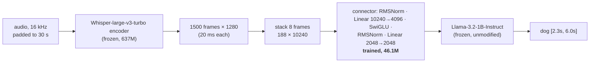

**Architecture.** The connector has the same shape as llama.cpp's built-in Ultravox projector, so
`export_audio_mmproj.py` can write the frozen Whisper encoder and the trained connector into an
mmproj with llama.cpp's own converter. Stacking 8 Whisper frames gives one LLM token per 160 ms of
audio, so a 30-second window becomes 188 tokens, about as many as an image.

**Tasks** (half speech, half sounds):

| Data | Prompt | Target |
|---|---|---|
| LibriSpeech train-clean-100 (28.5k utterances, 100 h) | `Transcribe the audio.` | `Concord returned to its place amidst the tents.` |
| ESC-50 folds 1-4 (1,600 clips, 50 classes), each clip placed alone in a 6-15 s track | `What sound is this?` | `Thunderstorm.` |
| synthetic tracks of 1-3 non-overlapping ESC-50 events, 6-25 s, random gains and noise floor | `When can you hear the {sound}? Answer with timestamps.` | `[2.3s, 6.0s]` |
| same | `List the sounds in this audio with their timestamps.` | `dog [2.0s, 6.7s]`<br>`hen [7.6s, 12.6s]` |

Event boundaries come from each clip's energy envelope: 50 ms frames above -20 dB relative to the
clip's peak. Training ran for 8,000 steps at batch 8 (64k examples) with AdamW and lr 5e-4.

<p align="center">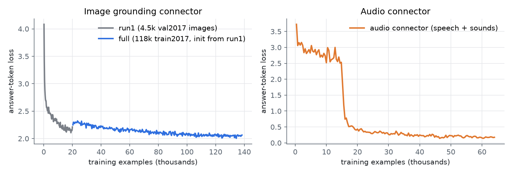</p>

The audio connector's loss stays flat for about 15k examples and then drops from 2.6 to 0.5 within
about 2k examples, which looks like the connector suddenly finding a usable mapping. The image
connector's loss falls gradually instead. In the left panel the image loss jumps when moving from
run1 to the full run, because run1 had seen its 4.5k images 4.4 times each and the train2017 images
were new.

### 5.2 Results

All tests are held out: LibriSpeech **test-clean** (first 300 utterances of at most 29.5 s), ESC-50
**fold 5** (400 clips never used in training), and 300 synthetic mixtures built from fold 5.

| Task | Metric | Ours | Shuffled audio | Baseline / reference |
|---|---|---|---|---|
| Speech transcription | WER ↓ | **5.3%** | 125% | Whisper-large-v3-turbo with its own decoder: 2.6% |
| Sound identification (50 classes) | accuracy | **65.7%** | 1.7% | chance: 2% |
| "When can you hear X?" | mean temporal IoU | **0.59** | 0.24 | whole-track answer: 0.32 |
| | Acc@0.5 | **64.3%** | 22.0% | whole-track answer: 13.0% |
| List sounds with timestamps | label precision / recall | **0.59 / 0.58** | 0.05 / 0.03 | |
| | events found at tIoU ≥ 0.5, label must match | **49%** | 1% | |
| | events found at tIoU ≥ 0.5, **any label** | **87%** | 32% | |

<p align="center">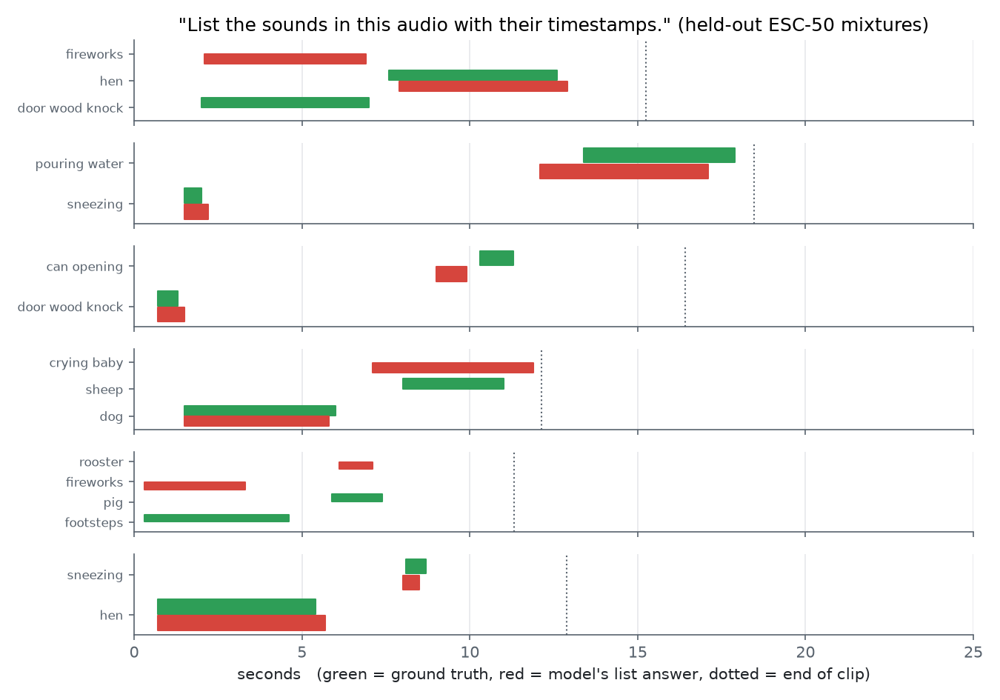</p>

**Speech.** Through a connector it was never trained with, the text-only LLM transcribes at 5.3% WER,
about twice the error of Whisper's own 4-layer decoder. 161 of the 300 utterances are transcribed
perfectly. Most errors are substitutions (244 of 338 word errors), such as "assurances" →
"assurance" and names ("Hans stirs not" → "Han stresses not"). WER is 3.6% on the shorter half of
utterances and 5.8% on the longer half, where the 1B model sometimes repeats a clause.

**Sounds.** Finding when an event happens works much better than naming it. Listing recovers 87% of
events with a correct time span if the label is ignored (32% for shuffled audio), and 49% with the
label required. The "when" question shows the same pattern by number of events in the clip:

| Events in clip | 1 | 2 | 3 |
|---|---|---|---|
| "When can you hear X?" Acc@0.5 | 96% | 47% | 40% |

With one event the model is nearly always right. With several it usually returns the span of one of
the events, often the first, instead of the one asked about. Identification errors are mostly between
classes that sound alike: coughing and sneezing, frog and dog, pig and cow, mouse click and keyboard
typing, insects and chainsaw.

**In llama.cpp.** The exported mmproj loads in a current llama.cpp. On 13 held-out test clips, 9
answers are identical to PyTorch, including all transcriptions and single-sound answers. The other 4
are three-event lists, where small numeric differences (Q8_0 LLM and f16 encoder in llama.cpp, bf16
in PyTorch) shift a timestamp or the bracket style, and in one case caused a repetition ("dog dog dog
[4.7s, 9.2s]"). The shuffled-audio WER above 100% comes from the model confidently transcribing a
different, often longer sentence when given the wrong audio.

## 6. Inside the latent space after training

To see where the tokens end up after training, `latent_blog.py` compares three kinds of tokens on 80
held-out COCO images (labelled by COCO masks) and 70 held-out audio clips:

- Qwen3.8's own projector output, compared with Qwen's words;
- the trained connector's output, compared with Llama's words;
- Qwen's image tokens passed through the Qwen-to-Llama word rotation, compared with Llama's words.

| Tokens | Mean length | Word vectors' length | Object name in 10 nearest words | Shuffled names | Object-vs-rest similarity to its word (AUC) |
|---|---|---|---|---|---|
| Qwen projector output · Qwen words | 2.21 | 0.41 | 0.1% | 0.2% | 0.48 |
| Word rotation · Llama words | 2.41 | 0.95 | 0.0% | 0.0% | n/a |
| **Vision connector · Llama words** | **23.1** | 0.95 | **2.6%** | 0.1% | **0.63** (119 objects) |
| **Audio connector · Llama words** | **92.0** | 0.95 | 0.0% | 0.0% | n/a |

The trained connectors do not make tokens word-like. Image tokens end up 24 times and audio tokens 96
times longer than Llama's word vectors, they point in directions no word uses, and their nearest
words are arbitrary ("asn", "cited", "moderate"). Llama can still read them because each of its
layers normalises the input before using it, so the direction of a vector matters more than its
length. Training found directions that the frozen layers respond to.

There is a weak pull toward meaning. Within an image, an object's Qwen tokens are no closer to the
object's word than background tokens are (AUC 0.48). After the connector they are somewhat closer to
Llama's word for the object (AUC 0.63).

In a shared 2D projection, Llama's words, the vision tokens and the audio tokens occupy three separate
regions.

## 7. Transplanting a VLM's layers without training

A vision-language model's own LLM layers were trained to read its projector output. This section
tests whether we can copy its first *k* layers, frozen, and reach the target LLM with a fixed
transformation instead of a trained connector. `bridge_test.py` uses Qwen3-VL-2B as the donor: its
vision tower and first *k* LLM layers, including the DeepStack visual injections into layers 0-2. The
target is the unmodified Llama-3.2-1B. Each image's tokens go through the donor alone (image tokens
only, causal) and then through one of two transformations:

- **A, rotation:** the orthogonal Procrustes map between the two word-embedding tables, fitted on 24k
  shared words (top-1 1.00 on the fit set) and applied to the hidden states. Each vector is rescaled
  to Llama's mean word-embedding length.
- **B, decode and re-embed:** Qwen's final norm and output head decode each image token into its top-5
  Qwen tokens. These are mapped to Llama tokens with the identical BPE string (110k of 152k tokens
  match), and Llama receives the probability-weighted average of their Llama embeddings.

Llama is asked "What objects are in this image? Answer with a short list." on 100 held-out COCO
images. We count which COCO categories it names, matching synonyms such as man → person and sofa →
couch. Recall is over categories covering at least 1% of the image.

| Condition | Recall | Precision |
|---|---|---|
| No image | 0% | n/a |
| A, rotation, k = 0, 1, 2, 4, 12, 20, 24, 28 | 0-4% at every k | n/a |
| B, decode, k = 0 | 14% | 39% |
| B, decode, k = 1 | 23% | 40% |
| B, decode, k = 2 / 4 / 12 / 20 | 6% / 11% / 21% / 20% | 14-34% |
| B, decode, k = 24 | 45% | 49% |
| B, decode, k = 28 (every donor layer) | 50% | 54% |
| Qwen3-VL-2B answering itself | 83% | 63% |
| Trained connector (Section 3, same question) | 87% | 81% |

The rotation fails at every depth. It only aligns the input word tables, and the hidden states of
image tokens do not look like words (Section 6), so the rotation turns them into meaningless inputs
and Llama produces gibberish ("## of a = a = 0").

Decode-and-re-embed works partly, with no training and with an open vocabulary, because Llama
receives real word embeddings. For the skier image, 1 copied layer gives "Goggles, Ski, Pants, Boots,
Helmet" and 28 layers give "Ski poles, Goggles, Sunglasses, Striped scarf". Several of those objects
are outside COCO's 80 categories, where the trained connector fails (Section 4.4), so the COCO-only
score above undercounts this method. Quality does not rise steadily with *k*. It follows the logit
lens: a small bump after layer 1, a dip through the middle layers, and most of the gain from layer 24
on. The good settings therefore use most of the donor's 1.7B-parameter LLM.

Two limits remain. Words carry no coordinates, so this method cannot produce boxes. The decode step
also uses a 152k-way output head with top-k selection, which llama.cpp's mmproj graph cannot express
today.

### 7.1 Hybrid: decoded words alongside the trained connector

We tested whether the decoded words can add open vocabulary to the trained grounding connector. In
the **hybrid**, each image patch reaches Llama as two inputs, interleaved in raster order:

1. the trained connector's token;
2. the patch's decoded-word embedding from the donor's first layer (k = 1).

The two encoders share a 32-pixel token grid, and the alignment holds up: 1.9% of object patches
decode to the object's name, against 0.7-0.8% for transposed or shuffled orders. Starting from the
full connector, we trained 3,000 more steps on 32k train2017 images (`prep_hybrid.py`,
`train_hybrid.py`). A **control** ran the identical schedule without the word tokens. All three
connectors were evaluated with the same code (`eval_hybrid.py`).

| Connector | COCO Acc@0.5 | COCO IoU | Non-COCO (LVIS) Acc@0.5 | LVIS IoU |
|---|---|---|---|---|
| Full connector (reference) | 73.4% | 0.64 | 20.3% | 0.21 |
| Control: +3,000 steps, no words | 75.0% | 0.65 | 19.9% | 0.22 |
| **Hybrid: +3,000 steps, with decoded words** | 72.9% | 0.63 | 17.1% | 0.20 |

The hybrid does not help. It ignores the words even where they should matter most: on the 84
non-COCO questions whose query word appears among the image's decoded words, the hybrid scores 17.9%
and the control 20.2%. The likely reasons:

- every training question asks about a COCO category, which the connector's own tokens already
  carry, so nothing rewards reading the word tokens;
- the per-patch word signal after one donor layer is weak.

Making this work would need training questions that only the words can answer, such as LVIS
categories on train2017. That again points to the training data (Section 4.4).

Reading words decoded from the donor did not help. Section 8 lets the connector read the donor's
hidden states directly, and that gives the best grounding in this work.

## 8. Connector + donor: copy a VLM's first layers, then train a connector

Section 7 kept everything training-free and could not produce boxes. This section combines it with
Section 3. We copy a real VLM's vision tower and its first *k* LLM layers unchanged, then train a
connector from that point into the frozen target LLM, the same way as in Section 3. We call this
**connector + donor**. The scripts call it the transplant (`train_transplant.py`).

### 8.1 Connector vs connector + donor

Both designs train only a connector and keep the target LLM frozen. They differ in what the
connector receives.

| | Connector (Section 3) | Connector + donor (this section) |
|---|---|---|
| What goes into the connector | the vision tower's output | the vision tower's output after the donor VLM's first *k* language-model layers |
| Frozen parts before the connector | Qwen3.8 vision tower (416M) | Qwen3-VL-2B vision tower (407M) + 4 LLM layers (201M) |
| Trained connector | 30.7M | 16.8M |
| Needs the donor's text model | no | yes, its first *k* layers |
| Runs in llama.cpp | yes, as an mmproj | not yet |
| COCO "where" Acc@0.5, equal training | 74.0% | 85.9% |

The connector is a small network applied to each image token separately, so it cannot combine
information from neighbouring tokens. With a plain vision tower, each token mostly describes its own
32×32-pixel square. Working out that several squares belong to one object, and where that object
ends, needs information from many tokens at once. The connector cannot do that, and the frozen Llama
was never trained to do it with image tokens.

The donor's language-model layers are attention layers, so every image token can read every other
image token. Qwen3-VL trained these layers on large amounts of image data to turn raw patches into
something a language model can use. After them, a token carries context from the rest of the image,
and the connector only has to translate tokens from Qwen's format into Llama's. This is our
explanation of the results below. We have not tested it directly.

We copy the first layers. Section 7 found the last layers better for turning image tokens into
words, because deep layers are the ones that know object names. Boxes need position as well. In
early layers each token is still mostly about its own place in the image, while later layers spread
information across tokens and turn it into next-word predictions, which blurs position. The trained
connector also reads hidden states directly, so it does not depend on the late layers' naming
ability. The *k* sweep in 8.3 agrees: 4 layers beat 0 and 12.

The layers must be the first *k* in order (1, 2, ..., *k*). Each layer was trained on the output of
the layer before it, so a selection such as layers 1, 2 and 10 would give layer 10 inputs it has
never seen. The only choice is where to cut.

### 8.2 Method

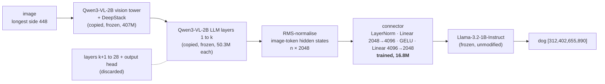

- **Donor.** Qwen3-VL-2B (2.13B parameters) runs on the image with its own chat template and a
  fixed "Describe." prompt. A hook stops the forward pass after layer *k* and keeps the hidden states
  at the image-token positions. Every layer after *k* and the output head are deleted, so at *k* = 4
  the donor costs the tower plus 4 layers: 407M + 4 × 50.3M = 608M parameters.
- **One token per 32×32-pixel patch**, in raster order. This is the same grid as the Qwen3.8
  connector, so boxes are possible.
- **RMS normalisation.** Hidden-state sizes grow from layer to layer, so each token is divided by its
  root-mean-square before the connector. The connector starts with a LayerNorm, which removes each
  token's scale anyway, so this step has almost no effect. It is kept so that all runs match. The
  connector's last layer is scaled at the start so its outputs begin at the size of Llama's word
  embeddings.
- **Training** follows Section 3: only the connector learns, the loss is next-token cross-entropy on
  the answer, and the three tasks are the same (lists with boxes 45%, "where is X?" 35%, one-sentence
  captions 20%).
- **Evaluation** uses the same 192 held-out COCO images and 246 non-COCO LVIS questions as Section 4,
  with the same scoring code.

### 8.3 Choosing k with a short sweep

*k* is not learned. We trained one connector per *k* on a short budget (32k train2017 images, 3,000
steps × 8, lr 3e-4) and compared them. A **matched baseline** trained the Section 3 connector on the
Qwen3.8 tower with the same budget.

<p align="center">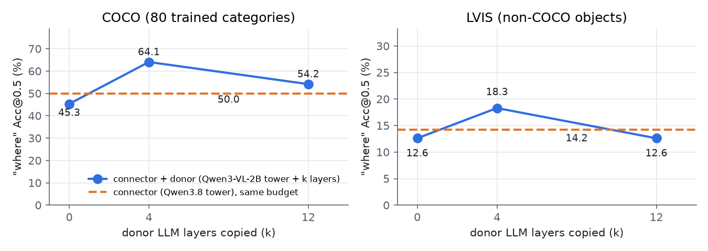</p>

| Vision side (all 3,000 steps, 32k images) | COCO Acc@0.5 | COCO IoU | COCO box P / R | LVIS Acc@0.5 | LVIS IoU |
|---|---|---|---|---|---|
| Qwen3.8 tower (matched baseline) | 50.0% | 0.49 | 0.22 / 0.26 | 14.2% | 0.19 |
| Qwen3-VL-2B tower, k = 0 | 45.3% | 0.46 | 0.22 / 0.24 | 12.6% | 0.18 |
| **Qwen3-VL-2B tower + 4 layers** | **64.1%** | **0.57** | **0.31 / 0.35** | **18.3%** | **0.23** |
| Qwen3-VL-2B tower + 12 layers | 54.2% | 0.53 | 0.27 / 0.31 | 12.6% | 0.17 |

<sub>k = 12 ran out of 8 GB at micro-batch 4, so it used micro-batch 2 with 4 accumulation steps (the same batch of 8).</sub>

With no layers (k = 0), Qwen3-VL-2B's tower scores slightly below Qwen3.8's, so the gain comes from
the copied layers and not from the different vision tower. Four layers help a lot and twelve help
less, which fits the position argument in 8.1. We only tried three values of *k*, so the best value
could be 2, 6 or 8.

There is one confound. Qwen3-VL injects extra vision-tower features (DeepStack) into LLM layers 0-2.
At k = 0 those injections never happen, and at k ≥ 3 all of them do. Part of the k = 4 gain may come
from those features and part from the layers' own processing. A k = 3 run, or a k = 0 run that adds
the DeepStack features by hand, would separate the two.

### 8.4 Equal footing: the full comparison

The short runs are enough to pick *k*, but they are under-trained. For the real comparison both
designs trained **from scratch with the same data and schedule**: all 118,287 train2017 images (one
epoch), 14,800 steps × 8 (micro-batch 2 × 4 accumulation), lr 3e-4 with 100 warm-up steps and cosine
decay, followed by the same held-out evaluation.

<p align="center">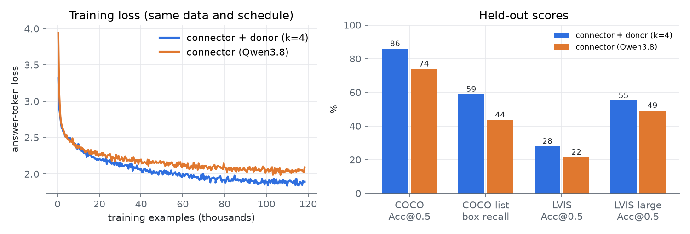</p>

| | **Connector + donor (k = 4)** | Connector (Qwen3.8) | run_full (Section 4, reference) | Qwen3-VL-2B (end-to-end VLM) |
|---|---|---|---|---|
| Trained parameters | **16.8M** | 30.7M | 30.7M | all 2.13B |
| COCO "where" Acc@0.5 | **85.9%** | 74.0% | 73.4% | 91.1% |
| COCO "where" IoU | **0.75** | 0.63 | 0.64 | 0.83 |
| Acc@0.5 small / medium / large (n = 9 / 85 / 98) | **67% / 79% / 94%** | 33% / 61% / 89% | 22% / 62% / 89% | 78% / 88% / 95% |
| COCO list, class P / R | **0.93 / 0.86** | 0.91 / 0.83 | 0.90 / 0.83 | n/a |
| COCO list, box P / R @0.5 | **0.58 / 0.59** | 0.42 / 0.44 | 0.45 / 0.48 | n/a |
| COCO list, duplicate lines | **12.6%** | 20.3% | 19.6% | n/a |
| LVIS (non-COCO) Acc@0.5 | **28.0%** | 21.5% | 20.3% | 84.6% |
| LVIS medium / large | **17.5% / 55.1%** | 10.7% / 49.3% | 11.9% / 42.0% | 80.2% / 95.7% |
| Final training loss | **1.89** | 2.09 | 2.06 | n/a |

<sub>run_full numbers here come from the same evaluation code (`eval_hybrid.py`) as the Qwen3.8 connector. Section 4 reports 74.0% from `eval_extra.py`; the difference is bf16 non-determinism. Qwen3-VL-2B by-size numbers are from Section 4.3.</sub>

The connector trained from scratch lands at 74.0% / 21.5%, close to run_full's 73.4% / 20.3%, so the
baseline is reproducible and the gap below does not come from a weak baseline run.

Connector + donor is better on every metric while training about half as many parameters. On COCO
it gets most of the way to the end-to-end VLM (85.9% vs 91.1%). It is the first of our models that
does reasonably on small objects (6 of 9), and it repeats itself less in lists.

The difference is statistically clear. On the same COCO questions, connector + donor is right where
the plain connector is wrong 31 times, and the reverse happens 8 times (exact McNemar p = 0.0003). On
LVIS the counts are 29 and 13 (p = 0.02).

Objects outside COCO are still hard. LVIS rises from 21.5% to 28.0%, far below Qwen3-VL-2B's 84.6%.
The copied layers add some open-vocabulary knowledge, and training on COCO's 80 categories still
limits generalisation (Section 4.4).

Training length mattered about as much as the design. The same k = 4 model went from 64.1% after
3,000 steps on 32k images to 85.9% after one epoch on 118k images.

<p align="center">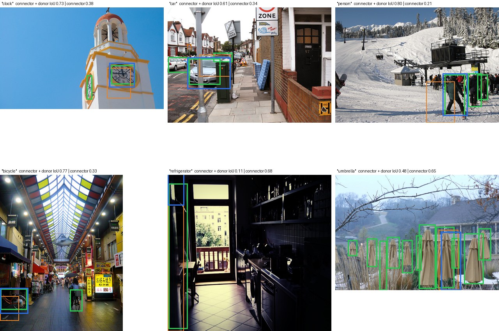</p>
<p align="center"><sub>"Where is the X?" on held-out COCO images where the two equal-footing runs disagree. Top row and bottom left: evenly spaced picks from the 31 questions only connector + donor gets right. Bottom middle and right: evenly spaced picks from the 8 only the plain connector gets right. <b>Green</b>: ground truth. <b>Blue</b>: connector + donor (k = 4). <b>Orange</b>: connector (Qwen3.8).</sub></p>

### 8.5 Image descriptions

20% of training examples are one-sentence captions, so connector + donor can also describe images.
On six held-out images, asked "Describe this image in one sentence.":

| COCO reference caption | Connector + donor (k = 4) with Llama-3.2-1B |
|---|---|
| A couple of cats laying on top of a pink blanket. | Two cats are laying on a couch together. |
| A woman stands in the dining area at the table. | A woman is standing in a living room with a television. |
| A woman posing for the camera standing on skis. | A woman skiing down a snowy hill. |
| Bedroom scene with a bookcase, blue comforter and window. | A bedroom with a bed, a desk, and a bookshelf. |
| The people are posing for a group photo. | A group of young people standing in front of a tennis court. |
| A stop sign is mounted upside-down on it's post. | A stop sign on a street with a truck parked next to it. |

Questions outside the three trained prompts work less well (see also Section 10).
"What is happening in this picture? Give some detail." sometimes gets a good sentence and sometimes a
loop ("A woman is standing in front of a table." repeated), because every training caption is a
single sentence. "What colors are the main objects?" gets an object list with boxes and no colours.
Adding detailed descriptions and question answering to the training mix (for example LLaVA
instruction data and VQAv2 on COCO images) should fix both. The architecture would stay the same.

### 8.6 Other LLMs, other donors, and llama.cpp

- **Each trained connector belongs to one combination of donor, *k* and LLM.** The connector learns
  to produce vectors that one particular frozen LLM understands. A different LLM needs its own
  connector, even if its hidden size is the same. Quantised versions of the same Llama should work
  unchanged, which we have not tested.
- **A new LLM only needs a new connector.** The donor and *k* can stay the same. We expect the best
  *k* to depend on the donor and not on the receiving LLM, which is also untested. For a 1B-class LLM
  one training run takes about 3.5 hours on this GPU.
- **A new donor VLM needs a new *k*.** Models differ in layer count and in how quickly their layers
  process images. "About the first 15% of layers" (4 of 28) is a starting guess from one donor. A
  cheaper way to choose *k* would be to probe every donor layer for position (a linear read-out of
  patch position and boxes) and for content (a linear read-out of the patch's object class), then
  confirm the best two or three candidates with short training runs. That scan is not built yet.
- **llama.cpp.** An mmproj holds a vision tower and a projector. Connector + donor also needs the
  donor's decoder layers, with Qwen3-VL's 3D rotary positions and DeepStack injection, to run inside
  the mmproj graph, which llama.cpp does not support. Until it does, this design runs in PyTorch, and
  the deployable mmproj is the Section 3 connector.

## 9. Training budget

All runs used one RTX 3070 Laptop GPU (8 GB) on a 13.8 GB-RAM machine that stayed in normal use.

| Run | Data | Steps × batch | GPU time | Wall clock | Peak VRAM | Trained / frozen params |
|---|---|---|---|---|---|---|
| Vision, run1 | 4.5k COCO images (features cached once) | 2,500 × 8 | 24 min | 24 min | 5.3 GB | 30.7M / 1.65B |
| Vision, full | 118k COCO images (encoder run live) | 14,800 × 8 | 3 h 15 min | 3 h 15 min | 6.1 GB | 30.7M / 1.65B |
| Audio | 100 h LibriSpeech + 1.6k ESC-50 clips | 8,000 × 8 | about 3 h 15 min | 6 h 46 min | 6.2 GB | 46.1M / 1.87B |
| Connector + donor sweep, k = 0 / 4 / 12 | 32k COCO images | 3 × 3,000 × 8 | 40 / 42 / 50 min | n/a | 6.3-6.7 GB | 16.8M / 1.65-2.25B |
| Matched baseline (Qwen3.8) | 32k COCO images | 3,000 × 8 | 42 min | n/a | 6.0 GB | 30.7M / 1.65B |
| **Equal footing, connector + donor (k = 4)** | 118k COCO images | 14,800 × 8 | 3 h 32 min | 3 h 55 min | 5.7 GB | 16.8M / 1.85B |
| **Equal footing, connector (Qwen3.8)** | 118k COCO images | 14,800 × 8 | 3 h 30 min | 3 h 30 min | 4.9 GB | 30.7M / 1.65B |

The runs listed took about 17 GPU-hours of training, plus a few hours of evaluation (each grounding
evaluation takes about 4 minutes). Wall clock is longer than GPU time when the RAM watchdog stopped a
run because free memory fell below 750 MB. The run then resumed from its last checkpoint; the
equal-footing connector + donor run was restarted 7 times this way. The trained connectors are 1.8%
(vision), 2.4% (audio) and 0.9% (connector + donor) of each pipeline's parameters.

## 10. Limitations

- **Closed vocabulary.** Grounding was trained only on COCO's 80 categories with three prompt
  templates. Outside them Acc@0.5 falls from 74% to 21% for the connector (Section 4.4) and from 86%
  to 28% for connector + donor (Section 8). The model also over-learned the answer format: "What
  colour is her jacket?" gets a bounding box and no colour. Audio has the same limit with 50 ESC-50
  sound classes.
- **Repetition in long lists.** Greedy decoding loops on scenes with many similar objects.
- **Small objects.** Acc@0.5 is 22% for objects under 1% of the image (67% for connector + donor, on
  only 9 questions).
- **The best model is not deployable yet.** Connector + donor needs decoder layers inside the mmproj,
  which llama.cpp does not support. Its *k* was chosen by hand from three values, and the DeepStack
  confound (Section 8.3) is open.
- **Binding in audio.** With several sounds in a clip, "when is X" often returns another event's span.
- **Synthetic audio scenes.** Timestamp tasks use artificial mixtures of non-overlapping clips. Real
  recordings with overlapping sounds would be harder.
- **Small LLM.** A 1B model limits how much it can say about an image beyond where things are.
- **Evaluation size.** 192 images (COCO), 246 questions (LVIS) and 300 clips per audio test, so
  differences of a few points are within noise.
- **Single seed.** Each configuration was trained once.

Planned next steps:

- train on LVIS (1,203 categories, same images), RefCOCO and Visual Genome, so grounding works beyond COCO's categories;
- mix in VQAv2 so ordinary questions get ordinary answers;
- deduplicate list targets to stop repetition;
- for audio, train on real recordings with overlapping sounds (AudioSet / AudioCaps) and on many-event clips, to fix label-to-segment binding;
- train a connector for a second LLM family, and for other mmproj files (Gemma 3, LLaVA-style), to test how general the recipe is;
- a `globalmm` option to choose between the closed-form matrix, a trained connector, and connector + donor;
- run the donor layers inside a llama.cpp mmproj so connector + donor ships as a file;
- build the per-layer probe scan to choose *k* for other donor VLMs, and run k = 2, 3, 6, 8 on Qwen3-VL-2B.

## 11. Reproducing

Copies of the scripts are in [`code/`](code/). They expect the workspace layout of `.globalmm/`:
`scripts/`, `dl/` for models, `coco/`, `audio/` and `analysis/`. Python dependencies are torch
(CUDA), transformers, safetensors, gguf, numpy, pillow, requests, ijson, pyarrow, soundfile, scipy,
jiwer and matplotlib.

All scripts live in `.globalmm/scripts/`. Heavy jobs run inside memory-capped `systemd-run` scopes
with a RAM and temperature watchdog, which let 3+ hour runs finish on an 8 GB laptop GPU while the
machine stayed in normal use.

```bash
# image grounding
python prep_coco_train.py && python fetch_coco_train.py ../coco/train448   # 118k images, resized on arrival
python train_connector.py train --steps 2500 --tag run1                      # run1 (val2017 features)
python train_full.py --steps 14800 --lr 2e-4 --init run1 --tag run_full     # full run
python train_connector.py eval --tag run_full && python eval_extra.py run_full run1
python export_mmproj.py ../analysis/grounding/run_full/connector.pt \
       ../dl/mmproj-Qwen3.8-Flash-Next-Q8_0.gguf ../dl/mmproj-qwen38-grounding-llama32-1b-full.gguf
python prep_lvis.py && python eval_ood.py run_full run1                     # out-of-distribution test
python eval_qwen3vl.py coco && python eval_qwen3vl.py lvis                  # reference VLM

# audio (Whisper-large-v3-turbo, LibriSpeech clean parquet from the HF mirror, ESC-50)
python prep_audio.py                                                         # ESC-50 -> 16 kHz + event extents
python train_audio.py train --steps 8000 --tag a1
python train_audio.py eval --tag a1 && python eval_whisper_ref.py 300
python export_audio_mmproj.py ../analysis/audio/a1/connector.pt ../dl/mmproj-whisper-audio-llama32-1b.gguf
python make_figures.py
python latent_blog.py                                                        # latent-space measurements
python bridge_test.py qwen && python bridge_test.py llama                    # training-free layer transplant
python prep_hybrid.py eval && python prep_hybrid.py train 32000              # decoded-word cache (donor layer 1)
bash hybrid_chain.sh                                                          # hybrid + control training, evaluation

# connector + donor (donor: Qwen/Qwen3-VL-2B-Instruct in ../dl/qwen3vl-2b)
python train_transplant.py train --k 4 --steps 3000                          # one sweep point (32k images)
python train_transplant.py eval  --k 4                                       # -> analysis/grounding/transplant_k4/eval.json
bash transplant_chain.sh                                                      # sweep k = 0, 4, 12: train + evaluate each
bash matched_chain.sh                                                         # Qwen3.8 connector, same 3k-step budget
bash equal_chain.sh                                                           # equal footing: both designs, 118k images, 14,800 steps
python make_transplant_figures.py                                            # Section 8 figures, size breakdown, McNemar test
```

The chain scripts wait until more than 3 GB of RAM is free, run each job in a memory-capped
`systemd-run` scope, and relaunch it after a watchdog stop. Training resumes from `ckpt.pt`, and a
job counts as finished when its log contains a line `DONE`.

The equal-footing chain runs these two commands, plus their evaluations:

```bash
python train_transplant.py train --k 4 --data full --steps 14800 --bs 2 --accum 4 --lr 3e-4 --tag eq_transplant_k4
python train_hybrid.py --no-words --init qwen --data full --steps 14800 --bs 2 --accum 4 --lr 3e-4 --tag eq_qwen38
```

**Using connector + donor from Python** (run from `scripts/`; there is no llama.cpp path yet):

```python
import torch
from PIL import Image
import train_connector as T, train_transplant as P

donor = P.Donor(4)                                   # Qwen3-VL-2B tower + first 4 LLM layers, frozen
tok, llm = T.load_llm("cuda")                        # Llama-3.2-1B-Instruct, frozen
conn = P.TConn().cuda()
conn.load_state_dict(torch.load(T.DATA / "eq_transplant_k4/connector.pt"))
B = T.Batcher(tok, None, None, None)

x = donor(P.fit32(Image.open("photo.jpg").convert("RGB")))   # longest side 448, sides multiples of 32
pre, post = B.prompt_parts("Where is the dog? Answer with bounding boxes.")
emb, att, _ = T.embed_batch(llm, conn, [(pre, x, post, [])], "cuda")
out = llm.generate(inputs_embeds=emb, attention_mask=att, max_new_tokens=60, do_sample=False)
print(tok.decode(out[0], skip_special_tokens=True))          # e.g. [312,402,655,890] on a 0-999 scale
```

**Using the connector mmproj.** You need a current llama.cpp. An older build (9940) gave visibly
degraded vision output.

```bash
llama-server -m Llama-3.2-1B-Instruct-Q8_0.gguf \
  --mmproj mmproj-qwen38-grounding-llama32-1b-full.gguf -c 4096 --image-max-tokens 256
```

Then ask `List the objects in this image with their bounding boxes.` or
`Where is the dog? Answer with bounding boxes.` Results are best when images are resized so the
longest side is 448 and both sides are multiples of 32, as in training.

For audio, swap the mmproj and keep the same language model file:

```bash
llama-server -m Llama-3.2-1B-Instruct-Q8_0.gguf \
  --mmproj mmproj-whisper-audio-llama32-1b.gguf -c 4096
```

Send a WAV as `input_audio` and ask `Transcribe the audio.`, `What sound is this?`,
`When can you hear the dog? Answer with timestamps.` or
`List the sounds in this audio with their timestamps.` Training used clips of up to 30 s. llama.cpp
splits longer audio into 30 s windows, which we have not tested.
